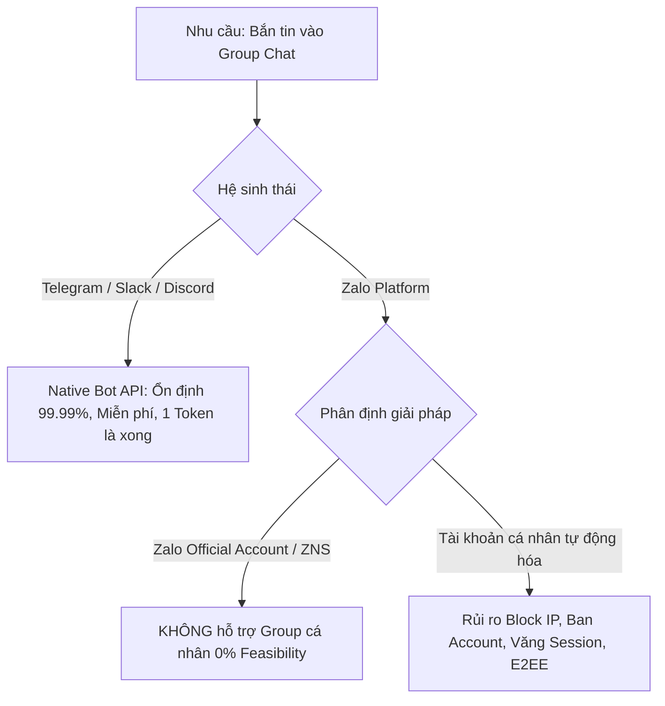
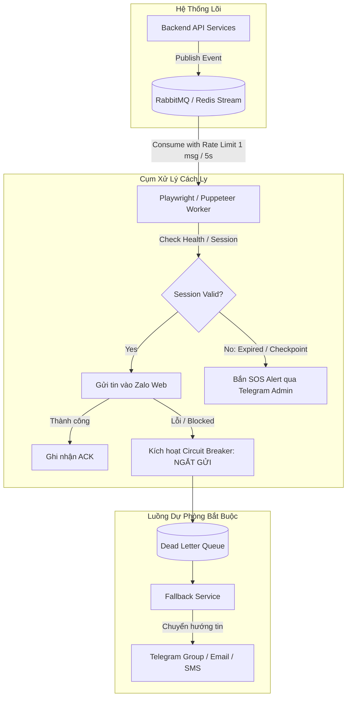

# BÁO CÁO PHÂN TÍCH KHẢ THI & RỦI RO KỸ THUẬT: TỰ ĐỘNG HÓA GỬI TIN NHẮN GROUP ZALO
> **Tác giả:** Tech Lead / Senior Systems Architect  
> **Phạm vi thẩm định:** Tích hợp API tự động hóa gửi tin nhắn vào Nhóm (Group) Zalo trong môi trường Production  
> **Tiêu chuẩn đánh giá:** Enterprise Reliability, Zero-Downtime, Compliance, Long-term Maintainability  

---

## 📌 1. EXECUTIVE SUMMARY & REALITY CHECK

Trong thực tế phát triển phần mềm doanh nghiệp, nhu cầu "bắn thông báo tự động vào nhóm Zalo" (nhóm nội bộ, nhóm khách hàng, nhóm vận hành) xuất hiện rất thường xuyên tại thị trường Việt Nam. Tuy nhiên, sự khác biệt giữa kỳ vọng của Product Owner/Management và thực tế kiến trúc của Zalo là **rất lớn**.



> [!CAUTION]
> **SỰ THẬT CỐT LÕI (GROUND TRUTH):**  
> Zalo **hoàn toàn KHÔNG cung cấp** Open API dạng Bot Token để tham gia và gửi tin nhắn vào Group chat cá nhân như Telegram hay Discord. Mọi giải pháp gửi tin vào Group Zalo hiện nay trên thị trường 100% là **Reverse Engineering (đi đường vòng)** hoặc **Tự động hóa trình duyệt (Headless Browser)** bằng tài khoản người dùng cá nhân.

---

## 🔬 2. BÓC TÁCH CHI TIẾT CÁC PHƯƠNG ÁN TRIỂN KHAI

### 2.1 Phương án 1: Zalo Official Platform (Zalo OA & ZNS)
* **Bản chất:** Sử dụng bộ API chính thống của VNG thông qua [Zalo Developers](https://developers.zalo.me/).
* **Khả năng gửi vào Group:** **0%**.
* **Đặc tính kỹ thuật:**
  * Chỉ tương tác 1:1 với người dùng đã nhấn "Quan tâm" OA.
  * Gửi tin CSKH/Giao dịch qua ZNS (Zalo Notification Service) tới số điện thoại cá nhân theo template được VNG phê duyệt trước.
  * Chi phí: Thu phí theo từng lượt tin (vài trăm VNĐ/tin).
* **Kết luận:** **Bế tắc về mặt kiến trúc** nếu mục tiêu bắt buộc phải là Group chat.

---

### 2.2 Phương án 2: Reverse Engineering Web Protocol (Zalo Web API)
* **Bản chất:** Phân tích luồng HTTP/WebSocket của `chat.zalo.me`, trích xuất cookie phiên (`zpw_sek`), decrypt payload và gửi request giả lập.
* **Thư viện thường dùng:** `zca-js` (Node.js), các wrapper mã nguồn mở trên GitHub.
* **Đánh giá chuyên sâu:**
  1. **Cơ chế mã hóa phức tạp:** Zalo sử dụng kết hợp AES-CBC/GCM, chữ ký HMAC và handshake WebSocket riêng.
  2. **Breaking Changes liên tục:** Đội ngũ an ninh của VNG thường xuyên thay đổi thuật toán mã hóa client-side, format query params, và cơ chế ký token định kỳ mỗi vài tuần/tháng. Khi Zalo cập nhật, toàn bộ code reverse sẽ **gãy hoàn toàn (hard crash)**.
  3. **End-to-End Encryption (E2EE):** Zalo đã và đang kích hoạt mã hóa đầu cuối cho các đoạn hội thoại và group. Reverse API thuần túy không thể giải mã hoặc sinh key E2EE hợp lệ nếu không nhúng toàn bộ WebAssembly/Crypto core của Zalo.

---

### 2.3 Phương án 3: Headless Browser Automation (Playwright / Puppeteer)
* **Bản chất:** Khởi chạy một trình duyệt Chromium ẩn danh trên server, nạp profile người dùng đã đăng nhập, tự động tìm selector input và mô phỏng sự kiện gõ phím/click chuột.
* **Đánh giá chuyên sâu:**
  1. **Chi phí tài nguyên (Resource Exhaustion):** Mỗi instance Chromium chiếm tối thiểu 300MB - 600MB RAM. Nếu chạy lâu ngày không kiểm soát memory leak, server sẽ sập vì OOM (Out Of Memory).
  2. **Tốc độ phản hồi (Latency):** Mất 3s - 8s cho một thao tác gửi tin (so với < 100ms của REST API chuẩn).
  3. **DOM Selector Flakiness:** Zalo Web thường xuyên làm rối mã nguồn (obfuscation) class names, khiến các selector CSS/XPath dễ bị vô hiệu hóa sau các bản release giao diện mới.

---

### 2.4 Phương án 4: Thuê Gateway Zalo API bên thứ ba (Third-party Unofficial Vendors)
* **Bản chất:** Các đơn vị dịch vụ dựng sẵn farm giả lập Android hoặc Zalo Web server để bán API (dạng trả phí thuê bao tháng).
* **Đánh giá chuyên sâu:**
  1. **Vendor Lock-in & Rủi ro bảo mật cực cao:** Bạn buộc phải giao session/cookie hoặc quét QR tài khoản nội bộ công ty lên server của bên thứ 3.
  2. **Không có cam kết SLA thực sự:** Khi VNG quét đợt lớn, toàn bộ farm của vendor sập, bạn hoàn toàn thụ động chờ họ vá lỗi.

---

## ⚡ 3. MA TRẬN RỦI RO THỰC TẾ TRONG VẬN HÀNH (PRODUCTION RISKS)

| # | Rủi ro | Mức độ nghiêm trọng | Tần suất xuất hiện | Hậu quả thực tế & Kịch bản sập |
| :-: | :--- | :---: | :---: | :--- |
| **1** | **Văng Session (Session Expired / Force Logout)** | **CỰC CAO (P0)** | 2 – 5 ngày / lần | Cookie hết hạn hoặc Zalo nghi ngờ phiên đăng nhập lạ, bắt quét mã QR xác thực lại. **Hệ thống tự động hóa bị tê liệt hoàn toàn** cho đến khi có người cầm điện thoại quét lại. |
| **2** | **Checkpoint & Khóa SIM vĩnh viễn (Account Banned)** | **CỰC CAO (P0)** | Tùy tần suất gửi | Thuật toán Anti-spam của Zalo phát hiện pattern gửi tin đều đặn theo chu kỳ máy móc. Tài khoản bị gắn cờ spam, khóa vĩnh viễn, **mất luôn số điện thoại doanh nghiệp**. |
| **3** | **Tắc nghẽn & Đánh rơi tin (Message Lost / Silent Drops)** | **CAO (P1)** | Thường xuyên khi tải cao | Không có cơ chế Webhook ACK chính thống. Tin nhắn gửi đi nhưng bị Zalo chặn thầm lặng (Silent Drop), người nhận không thấy tin nhưng hệ thống tưởng đã gửi thành công. |
| **4** | **Trùng lặp tin nhắn (Duplicate Spams)** | **TRUNG BÌNH (P2)** | Khi mạng timeout | Thiếu cơ chế Idempotency Key chuẩn. Khi retry tự động, một thông báo có thể bị bắn 5-10 lần liên tiếp vào group khách hàng, gây bức xúc nghiêm trọng. |
| **5** | **Rủi ro Pháp lý & Tuân thủ (Data Compliance)** | **CAO (P1)** | Tiềm ẩn liên tục | Vi phạm nghiêm trọng Điều khoản Dịch vụ (ToS) của VNG. Vi phạm Nghị định 13/2023/NĐ-CP nếu làm rò rỉ dữ liệu thông tin cá nhân trong nhóm chat do dùng session không được bảo vệ. |

---

## 📊 4. ĐÁNH GIÁ TỔNG THỂ THEO CHUẨN SENIOR PRO MAX (THANG ĐIỂM 10)

```text
[Feasibility]          ████░░░░░░  4.0/10  (PoC dễ, Production cực khó)
[Stability / SLA]      ██░░░░░░░░  2.5/10  (SLA dưới 85%, không đạt chuẩn Enterprise)
[Maintenance Burden]   ██░░░░░░░░  2.0/10  (Technical Debt khổng lồ, dev làm nô lệ sửa bot)
[Security & Privacy]   ███░░░░░░░  3.0/10  (Nguy cơ lộ lọt Session, vi phạm ToS)
[Scalability]          ███░░░░░░░  3.0/10  (Càng scale càng dễ bị khóa account)
────────────────────────────────────────────────────────────────────────
OVERALL SCORE:         ███░░░░░░░  2.9 / 10  ===> [KHÔNG ĐẠT TIÊU CHUẨN PRODUCTION]
```

### Chi tiết nhận xét từng tiêu chí:
1. **Tính khả thi (4.0/10):** Chạy demo trên máy tính cá nhân thì hoạt động trong 1 vài ngày đầu, nhưng để biến thành một service chạy headless 24/7 ổn định trong 6 tháng là bất khả thi nếu không có người túc trực bảo trì liên tục.
2. **Độ ổn định (2.5/10):** Không có SLA cam kết. Mọi phụ thuộc đều nằm trên nền cát lún của các giao thức không được tài liệu hóa (undocumented reverse protocols).
3. **Chi phí bảo trì (2.0/10):** Tốn kém nhân lực một cách lãng phí. Lương trả cho Senior Engineer ngồi reverse kỹ thuật mã hóa mỗi khi Zalo update cao hơn gấp nhiều lần chi phí mua các giải pháp thông báo chính thống.
4. **An toàn & Bảo mật (3.0/10):** Rủi ro lộ lọt dữ liệu nội bộ nếu máy chủ bot bị khai thác.
5. **Khả năng mở rộng (3.0/10):** Không hỗ trợ clustering/load-balancing. Zalo chỉ cho phép 1 session web hoạt động tích cực trên 1 tài khoản tại một thời điểm.

---

## 💣 5. NĂM THIẾU SÓT "CHẾT NGƯỜI" KHI ĐỀ XUẤT Ý TƯỞNG NÀY

> [!WARNING]
> Nếu một kỹ sư trình bày ý tưởng này lên bàn họp kiến trúc mà chưa chuẩn bị các câu trả lời sau, phương án sẽ bị bác bỏ ngay lập tức:

1. **Thiếu kịch bản On-call xử lý QR Checkpoint:** Khi 3 giờ sáng hệ thống cảnh báo bị văng session và bắt quét lại QR, ai sẽ chịu trách nhiệm thức dậy quét mã? Nếu không có người quét, toàn bộ luồng thông báo bị dồn ứ (deadlock) xử lý ra sao?
2. **Thiếu cơ chế Rate Limiting & Circuit Breaker:** Không có hàng đợi tin nhắn (Message Queue) cách ly. Khi một sự kiện backend nổ ra gửi dồn dập 50 tin nhắn trong 10 giây, Zalo lập tức gắn cờ DDOS/Spam và phong tỏa tài khoản.
3. **Không có hệ thống Fallback:** Nếu kênh Zalo bị ngắt kết nối, luồng thông tin quan trọng có được tự động chuyển hướng sang Telegram/SMS/Email hay biến mất vĩnh viễn?
4. **Không tính chi phí phần cứng cho Browser Automation:** Nghĩ là "viết script nhẹ nhàng", nhưng không tính toán tài nguyên khi Chromium rò rỉ RAM (leak DOM nodes) trên Docker container.
5. **Ảo tưởng về tính miễn phí:** Nghĩ dùng tài khoản cá nhân là "0 đồng", nhưng chi phí cơ hội khi mất số điện thoại doanh nghiệp và thời gian chết của hệ thống là vô giá.

---

## 🏛️ 6. BẢN THIẾT KẾ KIẾN TRÚC PHÒNG THỦ (NẾU BẮT BUỘC PHẢI TRIỂN KHAI)

Nếu Ban Giám đốc hoặc Khách hàng **bắt buộc 100% phải dùng Group Zalo** và chấp nhận toàn bộ rủi ro về mặt vận hành, kiến trúc bắt buộc phải được thiết kế theo nguyên tắc **Cô lập sự cố (Fault Isolation) & Tự phục hồi (Self-Healing)**:



### Các quy tắc kỹ thuật sống còn:
1. **Rate Limiting nghiêm ngặt:** Giới hạn tốc độ tối đa: 1 tin / 3-5 giây. Mỗi ngày không vượt quá ngưỡng an toàn cho phép của tài khoản cá nhân.
2. **Session Storage bền vững:** Lưu Cookie & User Profile Browser vào một volume gắn ngoài (Persistent Volume). Không bao giờ khởi tạo container mới mà không có profile cũ.
3. **Dead Letter Queue & Fallback tự động:** Mọi tin nhắn không thể gửi vào Zalo sau 3 lần retry có exponential backoff phải được đẩy sang kênh dự phòng (Telegram/Email) để người dùng không bị nhỡ thông tin khẩn cấp.
4. **Giám sát sức khỏe Worker (Heartbeat & Liveness Check):** Định kỳ mỗi 15 phút, worker phải tự kiểm tra xem giao diện `chat.zalo.me` có còn ở trạng thái đăng nhập hay đã bị đá ra màn hình quét QR.

---

## 🎯 7. KẾT LUẬN & ĐỀ XUẤT CHIẾN LƯỢC CHO BAN DỰ ÁN

| Kịch bản bài toán | Đề xuất tối ưu nhất từ Tech Lead |
| :--- | :--- |
| **Thông báo nội bộ / Cảnh báo lỗi Server / Giám sát vận hành** | **Dùng Telegram Bot hoặc Lark / Discord Webhook.** Chuẩn mực 100%, miễn phí, setup trong 15 phút, uptime 99.99%, không bao giờ sợ bị ban nick. |
| **Gửi thông báo tới Khách hàng bên ngoài (1:1)** | **Dùng Zalo Official Account + ZNS.** Chi phí vài trăm đồng/tin nhưng hợp pháp, uy tín thương hiệu cao, tích hợp REST API chính thống của VNG. |
| **Gửi tin vào Group thảo luận cá nhân (Bắt buộc)** | Chỉ chấp nhận làm dưới dạng **Feature phụ (Non-critical)**, có bản cam kết rủi ro rõ ràng với khách hàng/PO về SLA, và bắt buộc phải có kênh dự phòng song song. |

> *"Một kỹ sư thực chiến không bao giờ đặt uy tín của hệ thống phần mềm vào tay một giải pháp không chính thống thiếu cam kết SLA."*
