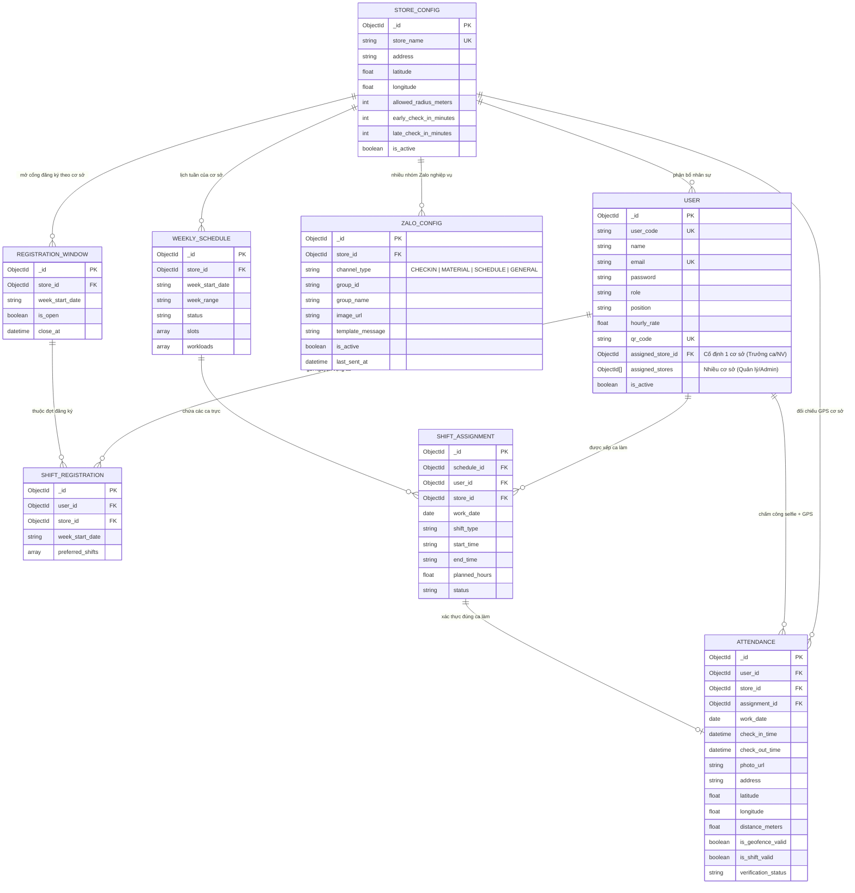

# 📐 SƠ ĐỒ QUAN HỆ THỰC THỂ (ERD) & CƠ CHẾ LIÊN KẾT ĐA CƠ SỞ

---

## 1. SƠ ĐỒ THỰC THỂ QUAN HỆ TỔNG THỂ (MERMAID ER DIAGRAM)

---

## 2. PHÂN TÍCH CÁC MỐI QUAN HỆ TRỌNG YẾU

### 2.1 Quan Hệ Giữa Cơ Sở (`store_configs`) và Nhân Sự (`users`)
- **Đối với Trưởng ca (`truong_ca`) & Nhân viên (`nhan_vien`):**
  - **Quan hệ 1 - N nghiêm ngặt (Strict Single Store):** Mỗi nhân viên hoặc trưởng ca bắt buộc có trường `assigned_store_id` trỏ về đúng 1 `StoreConfig._id`.
  - Không tồn tại khái niệm trưởng ca làm việc tại 2 cơ sở cùng lúc.
- **Đối với Quản lý (`quan_ly`):**
  - **Quan hệ N - N (Store Scoping):** Sử dụng trường `assigned_stores: [ObjectId]`. Quản lý được phân công giám sát 1 cơ sở hoặc một danh sách nhiều cơ sở.
- **Đối với Admin hệ thống (`admin_he_thong`):**
  - Quyền Super Admin toàn chuỗi: Nếu `assigned_stores` rỗng hoặc mang cờ `'ALL'`, Admin có quyền điều hành toàn bộ mọi cơ sở trong bảng `store_configs`. Nếu được phân quyền danh sách cụ thể thì giới hạn trong các cơ sở đó.

### 2.2 Quan Hệ Giữa Cơ Sở và Lịch Tuần (`weekly_schedules`)
- Mỗi bản ghi lịch tuần đại diện cho ma trận phân ca của **đúng 1 cơ sở trong 1 tuần cụ thể**.
- Compound Index: `{ store_id: 1, week_start_date: 1 }` đảm bảo mỗi cơ sở chỉ có duy nhất 1 bảng lịch cho mỗi tuần làm việc.
- Trưởng ca của cơ sở nào chỉ được đọc và tinh chỉnh bảng lịch có `store_id == currentUser.assigned_store_id`.

### 2.3 Quan Hệ Giữa Điểm Danh (`attendances`) và Ca Trực (`shift_assignments`)
- Khi nhân viên bấm check-in:
  - Hệ thống ghi nhận `user_id`, `store_id` của ca trực, `latitude`, `longitude` chụp từ thiết bị.
  - Đối chiếu khoảng cách Haversine với tọa độ chuẩn `(latitude, longitude)` trong `store_configs` của đúng cơ sở đó.
  - Lưu kết quả `distance_meters` và `is_geofence_valid = (distance_meters <= allowed_radius_meters)`.
  - Cờ `is_checked_in: true` trên ô ca của `weekly_schedules` được đồng bộ tức thời để phục vụ tính công minh bạch.

### 2.4 Quan Hệ Đa Nhóm Zalo Theo Nghiệp Vụ (`zalo_configs`)
- **Mô hình 1 Cơ Sở - Nhiều Nhóm Zalo Nghiệp Vụ:**
  - Nhằm chống spam và phân luồng thông tin chuẩn xác, 1 cơ sở (`store_id`) được liên kết với **nhiều nhóm Zalo** khác nhau phân loại theo trường `channel_type`:
    1. `channel_type = 'CHECKIN'`: Nhóm chuyên nhận thông báo điểm danh, ảnh selfie xác thực, nhắc nhở ca trực, cảnh báo nhân viên đi trễ hoặc vắng ca.
    2. `channel_type = 'MATERIAL'`: Nhóm chuyên nhận thông báo kho, cảnh báo nguyên vật liệu cạn kiệt (hết đá, hết sữa, hết siro) và đề xuất nhập hàng từ Phó ca vật liệu.
    3. `channel_type = 'SCHEDULE'`: Nhóm chuyên nhận thông báo chu kỳ tuần: mở cổng đăng ký ca, nhắc nhở nộp nguyện vọng và tự động bắn ảnh chụp bảng lịch tuần chính thức khi được duyệt.
    4. `channel_type = 'GENERAL'`: Nhóm trao đổi chung, phổ biến nội quy hoặc thông báo khẩn cấp toàn chi nhánh.
  - **Compound Unique Index:** `{ store_id: 1, channel_type: 1 }` đảm bảo mỗi cơ sở chỉ có duy nhất 1 nhóm Zalo phụ trách cho 1 loại nghiệp vụ.

