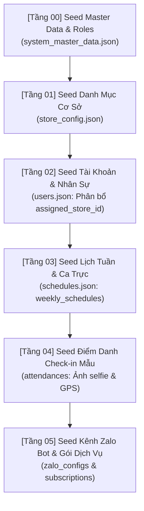

# 🚀 QUY TRÌNH SEED DỮ LIỆU, DỌN DẸP & ĐỒNG BỘ SCHEMA MONGODB ATLAS

Tài liệu này hướng dẫn cách thức vận hành luồng nạp dữ liệu mẫu (Seed Pipeline), quy trình dọn dẹp dữ liệu an toàn và cơ chế đồng bộ schema Prisma vào MongoDB Atlas cho toàn bộ hệ thống chuỗi đa cơ sở Zone Six.

---

## 1. QUY TRÌNH NẠP DỮ LIỆU MẪU PHÂN TẦNG (DEPENDENCY-DRIVEN SEED PIPELINE)

Để đảm bảo tính toàn vẹn quan hệ (Referential Integrity) giữa các Collection trên MongoDB Atlas, dữ liệu mẫu BẮT BUỘC phải được nạp tuần tự từ bảng cha đến bảng con theo 6 tầng phụ thuộc:



### Chi Tiết Từng Tầng Thực Thi:
1. **Tầng 00 (`00-system-roles.seed.ts`):** Khởi tạo các vai trò gốc và cấu hình tham số hệ thống.
2. **Tầng 01 (`02-store-config.seed.ts`):** Tạo danh mục các chi nhánh quán Cafe Zone Six (Cơ sở 1, Cơ sở 2) kèm tọa độ GPS và bán kính Geofence.
3. **Tầng 02 (`01-users.seed.ts`):** 
   - Tạo tài khoản Admin hệ thống (quyền toàn chuỗi).
   - Tạo tài khoản Quản lý (gán `assigned_stores = [CS1, CS2]`).
   - Tạo tài khoản Trưởng ca (gán cố định `assigned_store_id = CS1` hoặc `CS2`).
   - Tạo 21+ nhân viên Barista & Service gắn với từng cơ sở cụ thể.
4. **Tầng 03 (`03-schedules.seed.ts`):** Khởi tạo khung lịch tuần mẫu cho từng cơ sở và phân ca trực chi tiết cho nhân viên.
5. **Tầng 04 (`04-attendances.seed.ts`):** Nạp dữ liệu mẫu check-in hợp lệ (ảnh canvas có watermark địa chỉ, tọa độ GPS, khoảng cách < 50m).
6. **Tầng 05 (`05-subscriptions.seed.ts`):** Tạo cấu hình nhóm Zalo của từng cơ sở và gói phần mềm.

---

## 2. QUY TRÌNH DỌN DẸP DỮ LIỆU CŨ AN TOÀN (CLEAN DATABASE PIPELINE)

Trước khi chạy seed nạp dữ liệu mới, hàm `cleanDatabase()` trong `be/src/databases/seed/clean.ts` sẽ xóa dữ liệu cũ theo **CHIỀU NGƯỢC LẠI CỦA QUAN HỆ** để tránh tồn tại bản ghi mồ côi (orphan records):

```typescript
export async function cleanDatabase() {
  console.log("🧹 Đang dọn dẹp dữ liệu cũ theo chiều ngược quan hệ...");

  // 1. Xóa bảng lá (phụ thuộc cao nhất) trước
  await prisma.attendance.deleteMany();
  await prisma.notificationTruongCa.deleteMany();
  await prisma.notificationQuanLy.deleteMany();
  await prisma.notificationAdmin.deleteMany();
  await prisma.notificationPhoCaLamLich.deleteMany();
  await prisma.notificationPhoCaVatLieu.deleteMany();
  await prisma.notificationNhanVien.deleteMany();

  // 2. Xóa ca trực & lịch tuần
  await prisma.shiftAssignment.deleteMany();
  await prisma.shiftRegistration.deleteMany();
  await prisma.weeklySchedule.deleteMany();
  await prisma.registrationWindow.deleteMany();

  // 3. Xóa cấu hình kênh Zalo
  await prisma.zaloConfig.deleteMany();

  // 4. Xóa nhân viên & người dùng
  await prisma.user.deleteMany();

  // 5. Xóa cơ sở gốc (bảng cha) cuối cùng
  await prisma.storeConfig.deleteMany();
  await prisma.subscriptionPlan.deleteMany();

  console.log("✅ Đã dọn dẹp sạch sẽ CSDL MongoDB Atlas!");
}
```

---

## 3. CÁC LỆNH TERMINAL TIÊU CHUẨN

Mọi thao tác liên quan đến database được thực thi bên trong thư mục `be/`:

```bash
# 1. Đẩy schema Prisma trực tiếp lên MongoDB Atlas (Không cần migration table như SQL)
npx prisma db push

# 2. Sinh lại mã nguồn Prisma Client Typescript sau khi chỉnh sửa file .prisma
npx prisma generate

# 3. Chạy nạp dữ liệu mẫu (Seed) giữ nguyên dữ liệu cũ
npx tsx src/databases/seed/index.ts

# 4. Chạy dọn dẹp sạch 100% CSDL và nạp lại từ đầu (Khuyên dùng khi đổi cấu trúc lớn)
npx tsx src/databases/seed/index.ts --clean
```
