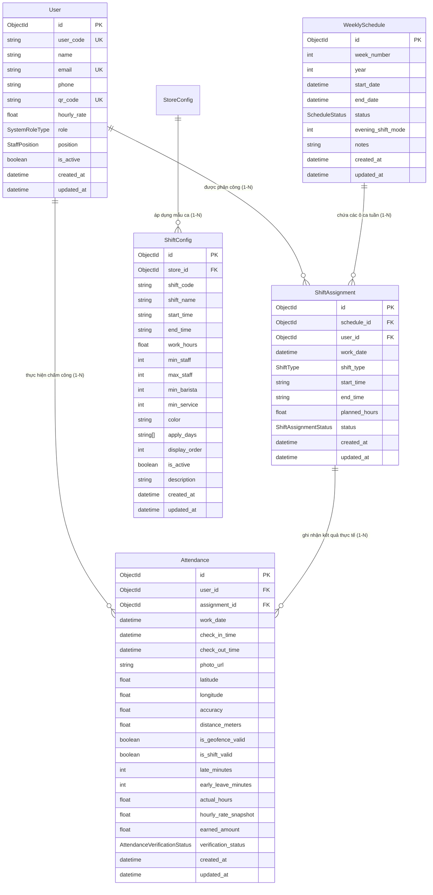
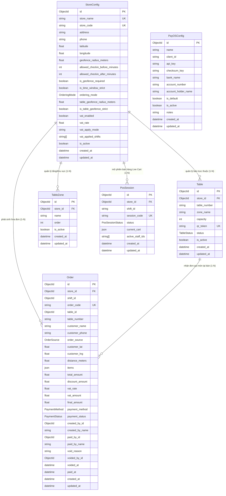
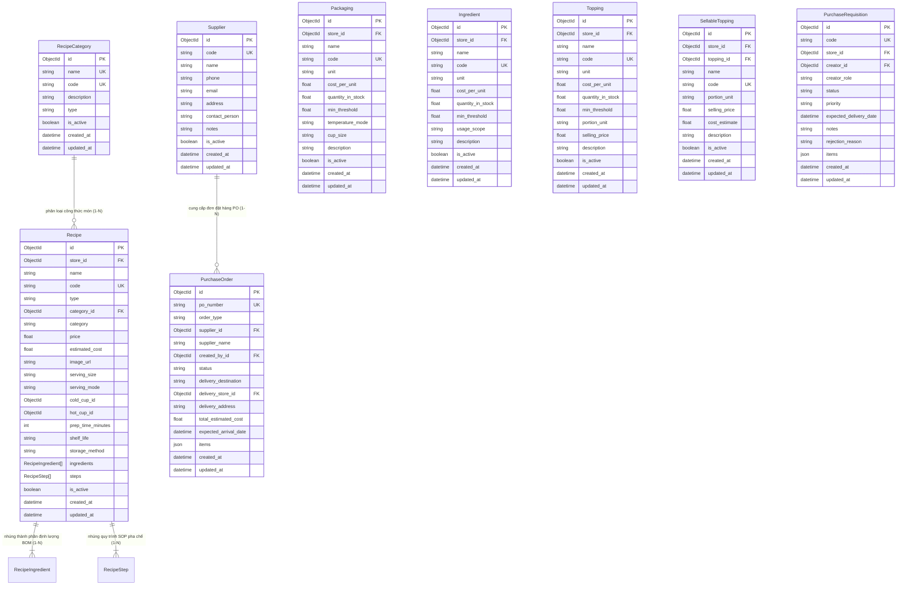

# 📚 BÁO CÁO ĐẶC TẢ CHI TIẾT CƠ SỞ DỮ LIỆU HỆ THỐNG ZONE SIX
## PHÂN HỆ ORM: PRISMA MULTI-FILE SCHEMA & MONGODB ATLAS

---

* **Học phần:** Cơ Sở Dữ Liệu Nâng Cao & Phát Triển Ứng Dụng Doanh Nghiệp
* **Đề tài ứng dụng:** Hệ Thống Quản Lý Chuỗi Lounge & Cafe Đa Chi Nhánh Zone Six (Zone Six Multi-Store Chain Management System)
* **Công nghệ Cơ sở dữ liệu:** MongoDB Atlas (Database: `zone_6`)
* **Công nghệ Truy vấn & ORM:** Prisma ORM 6.x (Kiến trúc Đa Tệp `prismaSchemaFolder`)
* **Đơn vị lưu trữ mã nguồn:** `be/src/databases/prisma/schema/`
* **Thời gian lập báo cáo:** Tháng 11/2026

---

## 📑 MỤC LỤC TỔNG QUAN

1. [Chương 1: Tổng Quan Kiến Trúc Cơ Sở Dữ Liệu](#chương-1-tổng-quan-kiến-trúc-cơ-sở-dữ-liệu)
   - 1.1 Mục tiêu thiết kế & Mô hình chuỗi đa cơ sở (Multi-Store Partitioning)
   - 1.2 Công nghệ cốt lõi & Quy ước định danh (Naming Conventions)
   - 1.3 Thống kê định lượng cấu trúc dữ liệu
2. [Chương 2: Sơ Đồ Quan Hệ Thực Thể Tổng Thể (Mermaid ERD)](#chương-2-sơ-đồ-quan-hệ-thực-thể-tổng-thể-mermaid-erd)
   - 2.1 Sơ đồ Phân hệ Nhân Sự, Lịch Ca & Điểm Danh Check-in
   - 2.2 Sơ đồ Phân hệ Bán Hàng POS, Sơ Đồ Bàn & Cổng Thanh Toán
   - 2.3 Sơ đồ Phân hệ Kho Vật Liệu, Công Thức Pha Chế (SOP) & Mua Sắm PO/PR
   - 2.4 Sơ đồ Phân hệ Thông Báo Đa Kênh & Zalo Bot Bridge
3. [Chương 3: Danh Mục Các Kiểu Dữ Liệu Liệt Kê (Enums Dictionary)](#chương-3-danh-mục-các-kiểu-dữ-liệu-liệt-kê-enums-dictionary)
4. [Chương 4: Đặc Tả Chi Tiết Từng Bảng Dữ Liệu & Thuộc Tính (Data Dictionary)](#chương-4-đặc-tả-chi-tiết-từng-bảng-dữ-liệu--thuộc-tính-data-dictionary)
   - Nhóm 1: Quản trị Tài khoản & Nhân sự (`User`)
   - Nhóm 2: Lịch ca & Điểm danh (`WeeklySchedule`, `ShiftAssignment`, `ShiftConfig`, `Attendance`)
   - Nhóm 3: Chi nhánh & Sơ đồ bàn (`StoreConfig`, `Table`, `TableZone`)
   - Nhóm 4: Bán hàng POS & Thanh toán (`Order`, `PosSession`, `PayOSConfig`)
   - Nhóm 5: Kho nguyên vật liệu & Topping (`Packaging`, `Ingredient`, `Topping`, `SellableTopping`, `Material`)
   - Nhóm 6: Sổ tay công thức & Định mức (`RecipeCategory`, `Recipe`, Composite Types: `RecipeIngredient`, `RecipeStep`)
   - Nhóm 7: Nhà cung ứng & Kiểm kê kho (`Supplier`, `InventoryAudit`, `InventoryAuditConfig`)
   - Nhóm 8: Mua sắm & Thu mua gộp đơn (`PurchaseRequisition`, `PurchaseOrder`)
   - Nhóm 9: Trung tâm thông báo 6 vai trò & Kênh Zalo (`NotificationAdmin`, `NotificationQuanLy`, `NotificationTruongCa`, `NotificationPhoCaLamLich`, `NotificationPhoCaVatLieu`, `NotificationNhanVien`, `ScheduleNotification`, `ZaloConfig`)
   - Nhóm 10: Gói dịch vụ nền tảng (`SubscriptionPlan`)
5. [Chương 5: Ma Trận Mối Quan Hệ Giữa Các Thực Thể (Relationship Matrix)](#chương-5-ma-trận-mối-quan-hệ-giữa-các-thực-thể-relationship-matrix)
   - 5.1 Các mối quan hệ cứng (Hard Relations qua Prisma `@relation`)
   - 5.2 Các mối quan hệ mềm theo định danh (Soft Relations qua `store_id`, `user_id` trong NoSQL)
   - 5.3 Các kiểu cấu trúc phức hợp nhúng (Embedded / Composite Types)
6. [Chương 6: Kết Luận & Đánh Giá Chất Lượng Thiết Kế](#chương-6-kết-luận--đánh-giá-chất-lượng-thiết-kế)

---

## 🏛️ CHƯƠNG 1: TỔNG QUAN KIẾN TRÚC CƠ SỞ DỮ LIỆU

### 1.1 Mục Tiêu Thiết Kế & Mô Hình Chuỗi Đa Cơ Sở (Multi-Store Partitioning)
Hệ thống quản lý chuỗi Zone Six được xây dựng nhằm giải quyết bài toán vận hành chuỗi F&B (Lounge & Cafe) với các đặc thù khắt khe:
1. **Phân lập dữ liệu đa cơ sở (Multi-Store Scoping):** Mọi thực thể vận hành (Bàn, Ca làm, Tồn kho, Hóa đơn, Cấu hình Zalo) đều được gắn định danh cơ sở (`store_id`).
   - Cấp **Admin Hệ Thống** có quyền chuyển đổi cơ sở (Store Switcher) hoặc quản lý toàn chuỗi.
   - Cấp **Quản Lý** quản lý danh sách chi nhánh được phân công.
   - Cấp **Trưởng Ca, Phó Ca, Nhân Viên** bị khóa cứng tại đúng **1 chi nhánh trực thuộc duy nhất**, đảm bảo không rò rỉ dữ liệu chéo.
2. **Bảo toàn giao dịch tài chính & Tính nhất quán (ACID & Audit Trail):**
   - Hóa đơn (`Order`) được lưu trữ vĩnh viễn theo dạng Snapshot (chụp lại giá trị món, tỷ lệ thuế VAT, giảm giá tại thời điểm thanh toán).
   - Nhật ký điểm danh (`Attendance`) lưu vết tọa độ GPS, bán kính Geofencing, thời gian thực tế và ảnh chụp camera khuôn mặt.

### 1.2 Công Nghệ Cốt Lõi & Quy Ước Định Danh (Naming Conventions)
* **Cơ sở dữ liệu:** MongoDB Atlas Replica Set (MongoDB 7.0+).
* **ORM:** Prisma Client v6.x, kích hoạt tính năng `previewFeatures = ["prismaSchemaFolder"]` cho phép chia nhỏ lược đồ thành 34 tệp độc lập nằm trong thư mục `be/src/databases/prisma/schema/`.
* **Quy ước đặt tên (Naming Conventions):**
  - **Tên Model (Thực thể):** Viết hoa chữ cái đầu theo chuẩn `PascalCase` (ví dụ: `WeeklySchedule`, `ShiftAssignment`, `StoreConfig`).
  - **Tên Collection (Bảng vật lý):** Ánh xạ sang chữ thường viết cách bằng dấu gạch dưới theo chuẩn `snake_case` số nhiều thông qua chỉ thị `@@map` (ví dụ: `@@map("weekly_schedules")`, `@@map("users")`).
  - **Tên Thuộc tính (Trong Prisma/TypeScript):** Viết hoa kiểu lạc đà `camelCase` (ví dụ: `storeId`, `hourlyRate`, `orderCode`).
  - **Tên Cột trong Database (BSON Field):** Ánh xạ sang `snake_case` thông qua chỉ thị `@map` (ví dụ: `@map("store_id")`, `@map("hourly_rate")`).
  - **Định danh khóa chính (Primary Key):** Luôn là `id String @id @default(auto()) @map("_id") @db.ObjectId`.

### 1.3 Thống Kê Định Lượng Cấu Trúc Dữ Liệu
* **Tổng số Bảng / Model Prisma:** **32 Models**
* **Tổng số Kiểu dữ liệu nhúng (Composite / Embedded Types):** **2 Types** (`RecipeIngredient`, `RecipeStep`)
* **Tổng số Kiểu liệt kê (Enums):** **15 Enums** (104 giá trị hằng số nghiệp vụ)
* **Tổng số Lược đồ Prisma Schema Files:** **34 Files** (`base.prisma`, `enum.prisma` và 32 files model)

---

## 📊 CHƯƠNG 2: SƠ ĐỒ QUAN HỆ THỰC THỂ TỔNG THỂ (MERMAID ERD)

### 2.1 Sơ Đồ Phân Hệ Nhân Sự, Lịch Ca & Điểm Danh Check-in

---

### 2.2 Sơ Đồ Phân Hệ Bán Hàng POS, Sơ Đồ Bàn & Cổng Thanh Toán

---

### 2.3 Sơ Đồ Phân Hệ Kho Vật Liệu, Công Thức Pha Chế (SOP) & Mua Sắm PO/PR

---

## 🔠 CHƯƠNG 3: DANH MỤC CÁC KIỂU DỮ LIỆU LIỆT KÊ (ENUMS DICTIONARY)

Toàn bộ các kiểu Enums được định nghĩa tập trung tại tệp [`be/src/databases/prisma/schema/enum.prisma`](file:///d:/DuAnCaNhan/zone_6/be/src/databases/prisma/schema/enum.prisma):

| Tên Kiểu Enum | Danh Sách Các Giá Trị Hợp Lệ | Mục Đích Nghiệp Vụ Sử Dụng Trong Hệ Thống |
| :--- | :--- | :--- |
| **`SystemRoleType`** | `ADMIN`, `MANAGER`, `STAFF`, `CUSTOMER` | Phân cấp tài khoản người dùng cấp cao của hệ thống. |
| **`StaffPosition`** | `BARISTA`, `SERVICE`, `CASHIER`, `SECURITY` | Vị trí chuyên môn làm việc của nhân viên tại cửa hàng. |
| **`ScheduleStatus`** | `DRAFT`, `PUBLISHED`, `ARCHIVED` | Trạng thái phê duyệt bảng lịch làm việc tuần của quán. |
| **`ShiftType`** | `MORNING`, `AFTERNOON`, `NIGHT` | Phân loại 3 khung ca trực truyền thống trong ngày. |
| **`ShiftAssignmentStatus`** | `ASSIGNED`, `CONFIRMED`, `CANCELLED`, `SWAPPED` | Vòng đời phân bổ ca của từng nhân viên trong lịch tuần. |
| **`AttendanceVerificationStatus`** | `VALID`, `WRONG_SHIFT`, `OUT_OF_RANGE`, `LATE`, `MANUAL_APPROVED` | Đánh giá độ tin cậy check-in dựa trên đối chiếu GPS & Thời gian ca. |
| **`NotificationSeverity`** | `LOW`, `MEDIUM`, `HIGH`, `URGENT` | Mức độ nghiêm trọng của thông báo vận hành hệ thống. |
| **`NotificationType`** | `UNCHECKED_EXPIRED_SHIFT`, `EMPTY_SLOT_1_DAY`, `EMPTY_SLOT_2_DAYS`, `EMPTY_SLOT_UPCOMING`, `OVERLOAD_ALERT`, `SCHEDULE_DEADLINE`, `MATERIAL_CHECK_REMINDER`, `SHIFT_PERSONAL_REMINDER`, `REGISTRATION_WINDOW_ALERT`, `GENERAL_INFO` | 10 mã định danh phân loại sự kiện nghiệp vụ phát sinh thông báo. |
| **`ZaloChannelType`** | `CHECKIN`, `MATERIAL`, `SCHEDULE`, `GENERAL` | 4 kênh định tuyến tin nhắn Zalo tự động theo nghiệp vụ. |
| **`PaymentMethod`** | `VIETQR`, `CASH`, `CARD` | Phương thức thanh toán hóa đơn khách hàng lựa chọn. |
| **`PaymentStatus`** | `PENDING`, `COMPLETED`, `CANCELLED` | Trạng thái giao dịch thanh toán của đơn hàng. |
| **`PosSessionStatus`** | `ACTIVE`, `CLOSED` | Trạng thái phiên làm việc POS Live Cart trong ca trực. |
| **`TableStatus`** | `AVAILABLE`, `OCCUPIED`, `RESERVED`, `MAINTENANCE` | 4 trạng thái vận hành thời gian thực của bàn ghế tại quán. |
| **`OrderingMode`** | `STAFF_ONLY`, `CUSTOMER_SELF_ORDER`, `HYBRID` | Chế độ cho phép khách tự quét QR đặt món hay chỉ nhân viên gọi. |
| **`OrderSource`** | `STAFF_POS`, `CUSTOMER_TABLE_QR` | Nguồn gốc xuất xứ của hóa đơn (tại quầy thu ngân hay tại bàn). |

---

## 📖 CHƯƠNG 4: ĐẶC TẢ CHI TIẾT TỪNG BẢNG DỮ LIỆU & THUỘC TÍNH (DATA DICTIONARY)

> **Ghi chú chuẩn:**
> - `PK`: Primary Key (Khóa chính)
> - `FK`: Foreign Key (Khóa ngoại tham chiếu)
> - `UK`: Unique Key (Ràng buộc duy nhất)
> - `IDX`: Index (Chỉ mục tăng tốc tìm kiếm)
> - `@map`: Tên trường lưu trữ thực tế trong MongoDB Document.

---

### 4.1 Nhóm 1: Quản Trị Tài Khoản & Nhân Sự

#### Bảng `User` (`users`)
* **Tệp khai báo:** `be/src/databases/prisma/schema/Users.prisma`
* **Mô tả chức năng:** Quản lý hồ sơ nhân sự, tài khoản xác thực, mã QR định danh chấm công và định mức lương giờ của chuỗi.

| STT | Thuộc Tính (Prisma) | Tên Cột DB (`@map`) | Kiểu Dữ Liệu | Kiểu MongoDB | Ràng Buộc / Khóa | Mặc Định | Mô Tả Ý Nghĩa Nghiệp Vụ |
| :-: | :--- | :--- | :--- | :--- | :--- | :--- | :--- |
| 1 | `id` | `_id` | `String` | `ObjectId` | **PK** | `auto()` | Mã định danh duy nhất của người dùng |
| 2 | `userCode` | `user_code` | `String` | `String` | **UK**, **IDX** | Không | Mã số nhân viên chuẩn hóa (`Z6-ADMIN`, `Z6-NV01`) |
| 3 | `name` | `name` | `String` | `String` | Bắt buộc | Không | Họ và tên đầy đủ của nhân viên |
| 4 | `email` | `email` | `String` | `String` | **UK**, **IDX** | Không | Địa chỉ thư điện tử dùng để đăng nhập |
| 5 | `phone` | `phone` | `String?` | `String` | Nullable | Không | Số điện thoại liên hệ cá nhân |
| 6 | `qrCode` | `qr_code` | `String` | `String` | **UK**, **IDX** | Không | Chuỗi mã hóa sinh mã QR in trên thẻ nhân viên số |
| 7 | `hourlyRate` | `hourly_rate` | `Float` | `Double` | Bắt buộc | `18000` | Mức lương cơ bản theo giờ (VNĐ/giờ) |
| 8 | `role` | `role` | `SystemRoleType` | `String` | Bắt buộc | `STAFF` | Vai trò hệ thống (`ADMIN`, `MANAGER`, `STAFF`...) |
| 9 | `position` | `position` | `StaffPosition` | `String` | Bắt buộc | `SERVICE` | Vị trí làm việc chính (`BARISTA`, `SERVICE`...) |
| 10 | `isActive` | `is_active` | `Boolean` | `Boolean` | Bắt buộc | `true` | Trạng thái hoạt động (`true`: Đang làm, `false`: Đã nghỉ) |
| 11 | `createdAt` | `created_at` | `DateTime` | `Date` | Bắt buộc | `now()` | Thời điểm tạo hồ sơ tài khoản |
| 12 | `updatedAt` | `updated_at` | `DateTime` | `Date` | Bắt buộc | `@updatedAt` | Thời điểm cập nhật hồ sơ gần nhất |

* **Quan hệ liên kết:**
  - `shiftAssignments`: `ShiftAssignment[]` (Quan hệ 1-N tới bảng `shift_assignments`).
  - `attendances`: `Attendance[]` (Quan hệ 1-N tới bảng `attendances`).

---

### 4.2 Nhóm 2: Lịch Ca & Điểm Danh Check-in

#### Bảng `WeeklySchedule` (`weekly_schedules`)
* **Tệp khai báo:** `be/src/databases/prisma/schema/weekly_schedule.prisma`
* **Mô tả chức năng:** Lưu trữ thông tin bảng lịch làm việc tuần tổng thể của từng tuần trong năm.

| STT | Thuộc Tính (Prisma) | Tên Cột DB (`@map`) | Kiểu Dữ Liệu | Kiểu MongoDB | Ràng Buộc / Khóa | Mặc Định | Mô Tả Ý Nghĩa Nghiệp Vụ |
| :-: | :--- | :--- | :--- | :--- | :--- | :--- | :--- |
| 1 | `id` | `_id` | `String` | `ObjectId` | **PK** | `auto()` | Khóa chính của bảng lịch tuần |
| 2 | `weekNumber` | `week_number` | `Int` | `Int32` | **UK (Compound)** | Không | Số thứ tự tuần trong năm (Tuần 1 $\rightarrow$ 52) |
| 3 | `year` | `year` | `Int` | `Int32` | **UK (Compound)** | Không | Năm áp dụng lịch làm việc (ví dụ: `2026`) |
| 4 | `startDate` | `start_date` | `DateTime` | `Date` | Bắt buộc | Không | Ngày bắt đầu tuần (Thứ Hai) |
| 5 | `endDate` | `end_date` | `DateTime` | `Date` | Bắt buộc | Không | Ngày kết thúc tuần (Chủ Nhật) |
| 6 | `status` | `status` | `ScheduleStatus` | `String` | Bắt buộc | `DRAFT` | Trạng thái lịch (`DRAFT`, `PUBLISHED`, `ARCHIVED`) |
| 7 | `eveningShiftMode` | `evening_shift_mode` | `Int` | `Int32` | Bắt buộc | `2` | Số lượng nhân sự phân bổ định biên ca tối |
| 8 | `notes` | `notes` | `String?` | `String` | Nullable | Không | Ghi chú vận hành của Quản lý / Trưởng ca |
| 9 | `createdAt` | `created_at` | `DateTime` | `Date` | Bắt buộc | `now()` | Thời điểm khởi tạo lịch |
| 10 | `updatedAt` | `updated_at` | `DateTime` | `Date` | Bắt buộc | `@updatedAt` | Thời điểm duyệt hoặc chỉnh sửa lịch |

* **Chỉ mục:** `@@unique([weekNumber, year])` - Đảm bảo mỗi tuần trong 1 năm chỉ tồn tại 1 bảng lịch duy nhất.
* **Quan hệ liên kết:** `shiftAssignments`: `ShiftAssignment[]` (Quan hệ 1-N).

---

#### Bảng `ShiftAssignment` (`shift_assignments`)
* **Tệp khai báo:** `be/src/databases/prisma/schema/shift_assignment.prisma`
* **Mô tả chức năng:** Lưu trữ chi tiết việc phân bổ từng nhân sự vào từng ca trực cụ thể theo ngày.

| STT | Thuộc Tính (Prisma) | Tên Cột DB (`@map`) | Kiểu Dữ Liệu | Kiểu MongoDB | Ràng Buộc / Khóa | Mặc Định | Mô Tả Ý Nghĩa Nghiệp Vụ |
| :-: | :--- | :--- | :--- | :--- | :--- | :--- | :--- |
| 1 | `id` | `_id` | `String` | `ObjectId` | **PK** | `auto()` | Khóa chính của phân bổ ca |
| 2 | `scheduleId` | `schedule_id` | `String` | `ObjectId` | **FK** | Không | Khóa ngoại liên kết tới `weekly_schedules.id` |
| 3 | `userId` | `user_id` | `String` | `ObjectId` | **FK**, **UK** | Không | Khóa ngoại liên kết tới `users.id` |
| 4 | `workDate` | `work_date` | `DateTime` | `Date` | **UK (Compound)** | Không | Ngày làm việc cụ thể trong tuần |
| 5 | `shiftType` | `shift_type` | `ShiftType` | `String` | **UK (Compound)** | Không | Loại ca (`MORNING`, `AFTERNOON`, `NIGHT`) |
| 6 | `startTime` | `start_time` | `String` | `String` | Bắt buộc | Không | Giờ bắt đầu ca định dạng `HH:mm` (vd: `07:00`) |
| 7 | `endTime` | `end_time` | `String` | `String` | Bắt buộc | Không | Giờ kết thúc ca định dạng `HH:mm` (vd: `12:30`) |
| 8 | `plannedHours` | `planned_hours` | `Float` | `Double` | Bắt buộc | `5.0` | Số giờ công kế hoạch dự kiến |
| 9 | `status` | `status` | `ShiftAssignmentStatus` | `String` | Bắt buộc | `ASSIGNED` | Trạng thái phân công (`ASSIGNED`, `CONFIRMED`...) |
| 10 | `createdAt` | `created_at` | `DateTime` | `Date` | Bắt buộc | `now()` | Thời điểm xếp ca |
| 11 | `updatedAt` | `updated_at` | `DateTime` | `Date` | Bắt buộc | `@updatedAt` | Thời điểm đổi ca hoặc cập nhật |

* **Chỉ mục:** `@@unique([userId, workDate, shiftType])` - Ngăn chặn lỗi trùng lặp nhân sự trong cùng 1 ca làm.
* **Quan hệ liên kết:**
  - `schedule`: Tham chiếu `WeeklySchedule` (`fields: [scheduleId], references: [id], onDelete: Cascade`).
  - `user`: Tham chiếu `User` (`fields: [userId], references: [id], onDelete: Cascade`).
  - `attendances`: `Attendance[]` (Quan hệ 1-N).

---

#### Bảng `ShiftConfig` (`shift_configs`)
* **Tệp khai báo:** `be/src/databases/prisma/schema/shift_config.prisma`
* **Mô tả chức năng:** Cấu hình danh mục ca làm việc, định biên nhân sự tối thiểu/tối đa và màu sắc nhận diện theo từng cơ sở.

| STT | Thuộc Tính (Prisma) | Tên Cột DB (`@map`) | Kiểu Dữ Liệu | Kiểu MongoDB | Ràng Buộc / Khóa | Mặc Định | Mô Tả Ý Nghĩa Nghiệp Vụ |
| :-: | :--- | :--- | :--- | :--- | :--- | :--- | :--- |
| 1 | `id` | `_id` | `String` | `ObjectId` | **PK** | `auto()` | Khóa chính cấu hình ca |
| 2 | `shiftCode` | `shift_code` | `String` | `String` | **UK (Compound)** | Không | Mã định danh ca (`CA_SANG`, `CA_CHIEU`, `CA_TOI`, `CA_KHUYA`) |
| 3 | `shiftName` | `shift_name` | `String` | `String` | Bắt buộc | Không | Tên hiển thị ca làm (ví dụ: `Ca Sáng`) |
| 4 | `startTime` | `start_time` | `String` | `String` | Bắt buộc | Không | Giờ bắt đầu ca định dạng `HH:mm` |
| 5 | `endTime` | `end_time` | `String` | `String` | Bắt buộc | Không | Giờ kết thúc ca định dạng `HH:mm` |
| 6 | `workHours` | `work_hours` | `Float` | `Double` | Bắt buộc | `5.0` | Số giờ công chuẩn tính lương của ca |
| 7 | `minStaff` | `min_staff` | `Int` | `Int32` | Bắt buộc | `2` | Số lượng nhân viên tối thiểu để mở ca |
| 8 | `maxStaff` | `max_staff` | `Int` | `Int32` | Bắt buộc | `4` | Số lượng nhân viên tối đa cho phép |
| 9 | `minBarista` | `min_barista` | `Int` | `Int32` | Bắt buộc | `1` | Định biên bắt buộc tối thiểu nhân viên Pha Chế |
| 10 | `minService` | `min_service` | `Int` | `Int32` | Bắt buộc | `1` | Định biên bắt buộc tối thiểu nhân viên Phục Vụ |
| 11 | `color` | `color` | `String` | `String` | Bắt buộc | `#D4AF37` | Mã màu HEX hiển thị trên giao diện xếp lịch |
| 12 | `applyDays` | `apply_days` | `String[]` | `Array[String]` | Bắt buộc | `["mon",...]` | Các thứ trong tuần ca này có hiệu lực |
| 13 | `displayOrder` | `display_order` | `Int` | `Int32` | Bắt buộc | `1` | Thứ tự sắp xếp hiển thị trên màn hình |
| 14 | `storeId` | `store_id` | `String?` | `ObjectId` | **FK**, **UK** | `null` | Chi nhánh áp dụng (`null` là áp dụng toàn chuỗi) |
| 15 | `isActive` | `is_active` | `Boolean` | `Boolean` | Bắt buộc | `true` | Bật/tắt ca làm việc |
| 16 | `description` | `description` | `String?` | `String` | Nullable | Không | Mô tả quy định riêng của ca |
| 17 | `createdAt` | `created_at` | `DateTime` | `Date` | Bắt buộc | `now()` | Thời điểm tạo ca |
| 18 | `updatedAt` | `updated_at` | `DateTime` | `Date` | Bắt buộc | `@updatedAt` | Thời điểm cập nhật ca |

* **Chỉ mục:** `@@unique([storeId, shiftCode])` - Đảm bảo mã ca không bị trùng lặp trong cùng 1 cơ sở.

---

#### Bảng `Attendance` (`attendances`)
* **Tệp khai báo:** `be/src/databases/prisma/schema/attendance.prisma`
* **Mô tả chức năng:** Lưu vết toàn diện lịch sử điểm danh check-in bằng camera thực tế và định vị GPS chống gian lận.

| STT | Thuộc Tính (Prisma) | Tên Cột DB (`@map`) | Kiểu Dữ Liệu | Kiểu MongoDB | Ràng Buộc / Khóa | Mặc Định | Mô Tả Ý Nghĩa Nghiệp Vụ |
| :-: | :--- | :--- | :--- | :--- | :--- | :--- | :--- |
| 1 | `id` | `_id` | `String` | `ObjectId` | **PK** | `auto()` | Khóa chính của bản ghi điểm danh |
| 2 | `userId` | `user_id` | `String` | `ObjectId` | **FK** | Không | Khóa ngoại liên kết tới nhân viên `users.id` |
| 3 | `assignmentId` | `assignment_id` | `String?` | `ObjectId` | **FK** | `null` | Khóa ngoại liên kết tới ca phân công tương ứng |
| 4 | `workDate` | `work_date` | `DateTime` | `Date` | Bắt buộc | Không | Ngày làm việc thực tế |
| 5 | `checkInTime` | `check_in_time` | `DateTime` | `Date` | Bắt buộc | Không | Thời điểm bấm máy chụp ảnh check-in chính xác |
| 6 | `checkOutTime` | `check_out_time` | `DateTime?` | `Date` | Nullable | `null` | Thời điểm check-out kết thúc ca làm |
| 7 | `photoUrl` | `photo_url` | `String` | `String` | Bắt buộc | Không | Ảnh selfie khuôn mặt có đóng watermark ngày giờ GPS |
| 8 | `latitude` | `latitude` | `Float` | `Double` | Bắt buộc | Không | Tọa độ vĩ độ GPS từ thiết bị lúc chụp ảnh |
| 9 | `longitude` | `longitude` | `Float` | `Double` | Bắt buộc | Không | Tọa độ kinh độ GPS từ thiết bị lúc chụp ảnh |
| 10 | `accuracy` | `accuracy` | `Float` | `Double` | Bắt buộc | `0` | Bán kính sai số định vị GPS (mét) |
| 11 | `distanceMeters` | `distance_meters` | `Float` | `Double` | Bắt buộc | Không | Khoảng cách tính từ vị trí chụp tới mốc GPS quán |
| 12 | `isGeofenceValid`| `is_geofence_valid` | `Boolean` | `Boolean` | Bắt buộc | Không | Hợp lệ bán kính quán (`true`: $\le$ bán kính cho phép) |
| 13 | `isShiftValid` | `is_shift_valid` | `Boolean` | `Boolean` | Bắt buộc | Không | Hợp lệ khung giờ mở check-in của ca |
| 14 | `lateMinutes` | `late_minutes` | `Int` | `Int32` | Bắt buộc | `0` | Số phút đi muộn so với giờ bắt đầu ca |
| 15 | `earlyLeaveMinutes`| `early_leave_minutes`| `Int` | `Int32` | Bắt buộc | `0` | Số phút về sớm trước khi hết ca |
| 16 | `actualHours` | `actual_hours` | `Float` | `Double` | Bắt buộc | `0` | Số giờ công thực tế ghi nhận |
| 17 | `hourlyRateSnapshot`| `hourly_rate_snapshot`| `Float`| `Double` | Bắt buộc | Không | Mức lương giờ chụp lại tại thời điểm chấm công |
| 18 | `earnedAmount` | `earned_amount` | `Float` | `Double` | Bắt buộc | `0` | Số tiền lương thực nhận của ca làm (VNĐ) |
| 19 | `verificationStatus`| `verification_status`| `AttendanceVerificationStatus`| `String`| Bắt buộc| `VALID`| Trạng thái xác thực (`VALID`, `OUT_OF_RANGE`, `LATE`...) |
| 20 | `createdAt` | `created_at` | `DateTime` | `Date` | Bắt buộc | `now()` | Thời điểm tạo bản ghi |
| 21 | `updatedAt` | `updated_at` | `DateTime` | `Date` | Bắt buộc | `@updatedAt` | Thời điểm duyệt hoặc chỉnh sửa |

* **Quan hệ liên kết:**
  - `user`: Tham chiếu `User` (`fields: [userId], references: [id], onDelete: Cascade`).
  - `assignment`: Tham chiếu `ShiftAssignment` (`fields: [assignmentId], references: [id], onDelete: SetNull`).

---

### 4.3 Nhóm 3: Chi Nhánh & Sơ Đồ Bàn (Multi-Store & Tables)

#### Bảng `StoreConfig` (`store_configs`)
* **Tệp khai báo:** `be/src/databases/prisma/schema/store_config.prisma`
* **Mô tả chức năng:** Quản lý danh mục các chi nhánh cơ sở, tọa độ Geofencing, chính sách check-in và cấu hình thuế VAT riêng cho từng cửa hàng.

| STT | Thuộc Tính (Prisma) | Tên Cột DB (`@map`) | Kiểu Dữ Liệu | Kiểu MongoDB | Ràng Buộc / Khóa | Mặc Định | Mô Tả Ý Nghĩa Nghiệp Vụ |
| :-: | :--- | :--- | :--- | :--- | :--- | :--- | :--- |
| 1 | `id` | `_id` | `String` | `ObjectId` | **PK** | `auto()` | Khóa chính của chi nhánh cơ sở |
| 2 | `storeName` | `store_name` | `String` | `String` | **UK** | Không | Tên hiển thị chi nhánh (vd: `Zone Six Cafe & Lounge`) |
| 3 | `storeCode` | `store_code` | `String?` | `String` | **UK** | `null` | Mã viết tắt cơ sở (vd: `Z6-CS01`, `Z6-CS02`) |
| 4 | `address` | `address` | `String` | `String` | Bắt buộc | Không | Địa chỉ thực tế lấy từ Reverse Geocoding GPS |
| 5 | `phone` | `phone` | `String?` | `String` | Nullable | `null` | Số điện thoại liên hệ hotline của chi nhánh |
| 6 | `latitude` | `latitude` | `Float` | `Double` | Bắt buộc | Không | Tọa độ vĩ độ tâm điểm của quán |
| 7 | `longitude` | `longitude` | `Float` | `Double` | Bắt buộc | Không | Tọa độ kinh độ tâm điểm của quán |
| 8 | `geofenceRadiusMeters`| `geofence_radius_meters`| `Float`| `Double` | Bắt buộc | `100` | Bán kính cho phép check-in nhân viên (mét) |
| 9 | `allowedCheckinBeforeMinutes`| `allowed_checkin_before_minutes`| `Int`| `Int32`| Bắt buộc| `30`| Thời gian mở check-in trước giờ vào ca (phút) |
| 10 | `allowedCheckinAfterMinutes`| `allowed_checkin_after_minutes`| `Int`| `Int32`| Bắt buộc| `30`| Thời gian tối đa cho phép vào ca trễ (phút) |
| 11 | `isGeofenceRequired`| `is_geofence_required`| `Boolean`| `Boolean`| Bắt buộc| `true`| Bắt buộc kiểm tra GPS khi nhân viên check-in |
| 12 | `isTimeWindowStrict`| `is_time_window_strict`| `Boolean`| `Boolean`| Bắt buộc| `true`| Khóa chặt khung giờ không cho check-in sai ca |
| 13 | `orderingMode` | `ordering_mode` | `OrderingMode` | `String` | Bắt buộc | `HYBRID` | Chế độ gọi món (`STAFF_ONLY`, `CUSTOMER_SELF_ORDER`, `HYBRID`) |
| 14 | `tableGeofenceRadiusMeters`| `table_geofence_radius_meters`| `Float`| `Double`| Bắt buộc| `30`| Bán kính Geofence chống troll đơn khi quét QR tại bàn |
| 15 | `isTableGeofenceStrict`| `is_table_geofence_strict`| `Boolean`| `Boolean`| Bắt buộc| `true`| Khóa màn hình gọi món nếu khách ở ngoài quán |
| 16 | `vatEnabled` | `vat_enabled` | `Boolean` | `Boolean` | Bắt buộc | `false` | Trạng thái kích hoạt tính thuế VAT của chi nhánh |
| 17 | `vatRate` | `vat_rate` | `Float` | `Double` | Bắt buộc | `8.0` | Tỷ lệ thuế suất giá trị gia tăng (%) |
| 18 | `vatApplyMode` | `vat_apply_mode` | `String` | `String` | Bắt buộc | `"ALL"` | Phạm vi áp dụng ca (`"ALL"` hoặc `"SPECIFIC_SHIFTS"`) |
| 19 | `vatAppliedShifts` | `vat_applied_shifts` | `String[]` | `Array[String]` | Bắt buộc | `[]` | Danh sách mã ca được áp dụng tính thuế VAT |
| 20 | `isActive` | `is_active` | `Boolean` | `Boolean` | Bắt buộc | `true` | Trạng thái hoạt động (`true`: Mở cửa, `false`: Tạm đóng) |
| 21 | `createdAt` | `created_at` | `DateTime` | `Date` | Bắt buộc | `now()` | Thời điểm tạo cơ sở |
| 22 | `updatedAt` | `updated_at` | `DateTime` | `Date` | Bắt buộc | `@updatedAt` | Thời điểm cập nhật cấu hình |

---

#### Bảng `Table` (`tables`)
* **Tệp khai báo:** `be/src/databases/prisma/schema/table.prisma`
* **Mô tả chức năng:** Quản lý sơ đồ bàn phân theo chi nhánh và tầng, mã token bảo mật QR mica dán tại bàn phục vụ tự gọi món.

| STT | Thuộc Tính (Prisma) | Tên Cột DB (`@map`) | Kiểu Dữ Liệu | Kiểu MongoDB | Ràng Buộc / Khóa | Mặc Định | Mô Tả Ý Nghĩa Nghiệp Vụ |
| :-: | :--- | :--- | :--- | :--- | :--- | :--- | :--- |
| 1 | `id` | `_id` | `String` | `ObjectId` | **PK** | `auto()` | Khóa chính của bàn |
| 2 | `storeId` | `store_id` | `String` | `ObjectId` | **FK**, **UK** | Không | Thuộc chi nhánh nào (`store_configs.id`) |
| 3 | `tableNumber` | `table_number` | `String` | `String` | **UK (Compound)** | Không | Số hiệu định danh bàn (`Bàn 01`, `Bàn 02`) |
| 4 | `zoneName` | `zone_name` | `String` | `String` | Bắt buộc | `"Sảnh Chính"`| Tên tầng / khu vực đặt bàn |
| 5 | `capacity` | `capacity` | `Int` | `Int32` | Bắt buộc | `4` | Số lượng chỗ ngồi thiết kế của bàn |
| 6 | `qrToken` | `qr_token` | `String` | `String` | **UK**, **IDX** | Không | Chuỗi token bảo mật chống giả mạo mã QR tại bàn |
| 7 | `status` | `status` | `TableStatus` | `String` | **IDX** | `AVAILABLE` | Trạng thái (`AVAILABLE`, `OCCUPIED`, `RESERVED`...) |
| 8 | `isActive` | `is_active` | `Boolean` | `Boolean` | Bắt buộc | `true` | Bàn còn hoạt động hay tạm ngưng |
| 9 | `createdAt` | `created_at` | `DateTime` | `Date` | Bắt buộc | `now()` | Thời điểm tạo bàn |
| 10 | `updatedAt` | `updated_at` | `DateTime` | `Date` | Bắt buộc | `@updatedAt` | Thời điểm cập nhật trạng thái bàn |

* **Chỉ mục:**
  - `@@unique([storeId, tableNumber])` - Đảm bảo trong 1 chi nhánh không có 2 bàn trùng số hiệu.
  - `@@index([storeId, status])` - Tối ưu truy vấn sơ đồ bàn và lọc bàn trống thời gian thực.

---

#### Bảng `TableZone` (`table_zones`)
* **Tệp khai báo:** `be/src/databases/prisma/schema/table_zone.prisma`
* **Mô tả chức năng:** Quản lý các tầng và khu vực vật lý của từng chi nhánh (Tầng 1, Tầng 2, Sân Thượng, Khu VIP).

| STT | Thuộc Tính (Prisma) | Tên Cột DB (`@map`) | Kiểu Dữ Liệu | Kiểu MongoDB | Ràng Buộc / Khóa | Mặc Định | Mô Tả Ý Nghĩa Nghiệp Vụ |
| :-: | :--- | :--- | :--- | :--- | :--- | :--- | :--- |
| 1 | `id` | `_id` | `String` | `ObjectId` | **PK** | `auto()` | Khóa chính khu vực tầng |
| 2 | `storeId` | `store_id` | `String` | `ObjectId` | **FK**, **UK** | Không | Chi nhánh sở hữu tầng này |
| 3 | `name` | `name` | `String` | `String` | **UK (Compound)** | Không | Tên hiển thị khu vực (`Tầng 1`, `Tầng 2`...) |
| 4 | `order` | `order` | `Int` | `Int32` | Bắt buộc | `0` | Thứ tự sắp xếp từ thấp lên cao |
| 5 | `isActive` | `is_active` | `Boolean` | `Boolean` | Bắt buộc | `true` | Trạng thái sử dụng của khu vực |
| 6 | `createdAt` | `created_at` | `DateTime` | `Date` | Bắt buộc | `now()` | Thời điểm tạo khu vực |
| 7 | `updatedAt` | `updated_at` | `DateTime` | `Date` | Bắt buộc | `@updatedAt` | Thời điểm chỉnh sửa khu vực |

* **Chỉ mục:** `@@unique([storeId, name])`, `@@index([storeId])`.

---

### 4.4 Nhóm 4: Bán Hàng POS & Thanh Toán (POS & Orders)

#### Bảng `Order` (`orders`)
* **Tệp khai báo:** `be/src/databases/prisma/schema/order.prisma`
* **Mô tả chức năng:** Lưu trữ toàn bộ hóa đơn thanh toán, chi tiết các món, topping, chiết khấu, thuế VAT và thông tin hủy đơn có kiểm toán.

| STT | Thuộc Tính (Prisma) | Tên Cột DB (`@map`) | Kiểu Dữ Liệu | Kiểu MongoDB | Ràng Buộc / Khóa | Mặc Định | Mô Tả Ý Nghĩa Nghiệp Vụ |
| :-: | :--- | :--- | :--- | :--- | :--- | :--- | :--- |
| 1 | `id` | `_id` | `String` | `ObjectId` | **PK** | `auto()` | Khóa chính của đơn hàng |
| 2 | `storeId` | `store_id` | `String` | `ObjectId` | **FK**, **IDX** | Không | Đơn hàng phát sinh tại chi nhánh nào |
| 3 | `shiftId` | `shift_id` | `String?` | `ObjectId` | Nullable | `null` | Thuộc ca làm việc nào |
| 4 | `orderCode` | `order_code` | `String` | `String` | **UK**, **IDX** | Không | Mã hóa đơn in bill (`#Z6-CS01-20261105-0001`) |
| 5 | `tableId` | `table_id` | `String?` | `ObjectId` | Nullable | `null` | Khóa ngoại tới bàn (`null` nếu là khách Mang về) |
| 6 | `tableNumber` | `table_number` | `String?` | `String` | Nullable | `null` | Tên bàn lưu dưới dạng chuỗi (`Bàn 01` hoặc `Mang về`) |
| 7 | `customerName` | `customer_name` | `String?` | `String` | Nullable | `null` | Tên khách hàng (mặc định là `Khách lẻ`) |
| 8 | `customerPhone`| `customer_phone`| `String?` | `String` | Nullable | `null` | Số điện thoại tích điểm của khách |
| 9 | `deviceId` | `device_id` | `String?` | `String` | Nullable | `null` | Định danh thiết bị của khách tự đặt qua QR |
| 10 | `deviceName` | `device_name` | `String?` | `String` | Nullable | `null` | Tên thiết bị (iPhone, Samsung...) |
| 11 | `orderSource` | `order_source` | `OrderSource` | `String` | Bắt buộc | `STAFF_POS` | Nguồn tạo đơn (`STAFF_POS` hay `CUSTOMER_TABLE_QR`) |
| 12 | `customerLat` | `customer_lat` | `Float?` | `Double` | Nullable | `null` | Vĩ độ khách hàng lúc bấm đặt món |
| 13 | `customerLng` | `customer_lng` | `Float?` | `Double` | Nullable | `null` | Kinh độ khách hàng lúc bấm đặt món |
| 14 | `distanceMeters`| `distance_meters`| `Float?` | `Double` | Nullable | `null` | Khoảng cách từ thiết bị khách tới quán |
| 15 | `items` | `items` | `Json` | `Array[Document]`| Bắt buộc | Không | Chi tiết danh sách món, topping, size, giá tiền |
| 16 | `totalAmount` | `total_amount` | `Float` | `Double` | Bắt buộc | Không | Tổng tiền thô của toàn bộ món (VNĐ) |
| 17 | `discountAmount`| `discount_amount`| `Float` | `Double` | Bắt buộc | `0` | Tiền giảm giá / khuyến mãi (VNĐ) |
| 18 | `vatRate` | `vat_rate` | `Float` | `Double` | Bắt buộc | `0` | Tỷ lệ thuế suất VAT áp dụng (%) |
| 19 | `vatAmount` | `vat_amount` | `Float` | `Double` | Bắt buộc | `0` | Tiền thuế giá trị gia tăng thực thu (VNĐ) |
| 20 | `finalAmount` | `final_amount` | `Float` | `Double` | Bắt buộc | Không | Tiền thanh toán cuối cùng = Total - Discount + VAT |
| 21 | `paymentMethod`| `payment_method`| `PaymentMethod`| `String` | Bắt buộc | `VIETQR` | Hình thức (`VIETQR`, `CASH`, `CARD`) |
| 22 | `paymentStatus`| `payment_status`| `PaymentStatus`| `String` | Bắt buộc | `COMPLETED` | Trạng thái thanh toán (`PENDING`, `COMPLETED`...) |
| 23 | `createdById` | `created_by_id` | `String?` | `ObjectId` | Nullable | `null` | ID nhân sự tạo đơn |
| 24 | `createdByName`| `created_by_name`| `String` | `String` | Bắt buộc | Không | Tên người tạo đơn hoặc `Khách tại bàn` |
| 25 | `paidById` | `paid_by_id` | `String?` | `ObjectId` | Nullable | `null` | ID nhân sự thu ngân xác nhận tiền |
| 26 | `paidByName` | `paid_by_name` | `String?` | `String` | Nullable | `null` | Tên nhân sự thu ngân |
| 27 | `voidReason` | `void_reason` | `String?` | `String` | Nullable | `null` | Lý do hủy đơn hàng (bắt buộc khi Void bill) |
| 28 | `voidedById` | `voided_by_id` | `String?` | `ObjectId` | Nullable | `null` | ID Quản lý/Trưởng ca thực hiện hủy đơn |
| 29 | `voidedByName` | `voided_by_name` | `String?` | `String` | Nullable | `null` | Tên người hủy đơn |
| 30 | `voidedAt` | `voided_at` | `DateTime?` | `Date` | Nullable | `null` | Thời điểm hủy đơn hàng |
| 31 | `paidAt` | `paid_at` | `DateTime?` | `Date` | Nullable | `null` | Thời điểm thanh toán thành công |
| 32 | `createdAt` | `created_at` | `DateTime` | `Date` | **IDX** | `now()` | Thời điểm tạo hóa đơn |
| 33 | `updatedAt` | `updated_at` | `DateTime` | `Date` | Bắt buộc | `@updatedAt` | Thời điểm cập nhật đơn |

* **Chỉ mục:** `@@index([storeId, createdAt])` - Hỗ trợ lọc thống kê doanh thu theo chi nhánh và khoảng thời gian.

---

#### Bảng `PosSession` (`pos_sessions`)
* **Tệp khai báo:** `be/src/databases/prisma/schema/pos_session.prisma`
* **Mô tả chức năng:** Quản lý giỏ hàng trực tiếp (Live Cart) theo thời gian thực giữa các thiết bị thu ngân và pha chế trong cùng một ca trực.

| STT | Thuộc Tính (Prisma) | Tên Cột DB (`@map`) | Kiểu Dữ Liệu | Kiểu MongoDB | Ràng Buộc / Khóa | Mặc Định | Mô Tả Ý Nghĩa Nghiệp Vụ |
| :-: | :--- | :--- | :--- | :--- | :--- | :--- | :--- |
| 1 | `id` | `_id` | `String` | `ObjectId` | **PK** | `auto()` | Khóa chính phiên POS |
| 2 | `storeId` | `store_id` | `String` | `ObjectId` | **FK**, **UK** | Không | Chi nhánh của ca trực |
| 3 | `shiftId` | `shift_id` | `String` | `String` | **UK (Compound)** | Không | Định danh ca làm việc |
| 4 | `sessionCode` | `session_code` | `String` | `String` | **UK** | Không | Mã định danh phiên bán hàng |
| 5 | `status` | `status` | `PosSessionStatus` | `String` | Bắt buộc | `ACTIVE` | Trạng thái phiên (`ACTIVE`, `CLOSED`) |
| 6 | `currentCart` | `current_cart` | `Json` | `Document` | Bắt buộc | Không | Dữ liệu giỏ hàng Live Cart đồng bộ qua WebSocket |
| 7 | `activeStaffIds`| `active_staff_ids`| `String[]` | `Array[String]` | Bắt buộc | `[]` | Danh sách ID nhân sự đang online trong ca |
| 8 | `createdAt` | `created_at` | `DateTime` | `Date` | Bắt buộc | `now()` | Thời điểm mở phiên |
| 9 | `updatedAt` | `updated_at` | `DateTime` | `Date` | Bắt buộc | `@updatedAt` | Thời điểm cập nhật Live Cart |

* **Chỉ mục:** `@@unique([storeId, shiftId, sessionCode])`.

---

#### Bảng `PayOSConfig` (`payos_configs`)
* **Tệp khai báo:** `be/src/databases/prisma/schema/payos_config.prisma`
* **Mô tả chức năng:** Cấu hình tài khoản cổng thanh toán Open Banking PayOS (Client ID, API Key, Checksum Key) để tự động sinh mã VietQR động.

| STT | Thuộc Tính (Prisma) | Tên Cột DB (`@map`) | Kiểu Dữ Liệu | Kiểu MongoDB | Ràng Buộc / Khóa | Mặc Định | Mô Tả Ý Nghĩa Nghiệp Vụ |
| :-: | :--- | :--- | :--- | :--- | :--- | :--- | :--- |
| 1 | `id` | `_id` | `String` | `ObjectId` | **PK** | `auto()` | Khóa chính cấu hình PayOS |
| 2 | `name` | `name` | `String` | `String` | Bắt buộc | Không | Tên gợi nhớ (vd: `PayOS MBBank Chính Quán Zone Six`) |
| 3 | `clientId` | `client_id` | `String` | `String` | Bắt buộc | Không | Mã Client ID được cấp từ cổng PayOS |
| 4 | `apiKey` | `api_key` | `String` | `String` | Bắt buộc | Không | Khóa API Key bí mật kết nối |
| 5 | `checksumKey` | `checksum_key` | `String` | `String` | Bắt buộc | Không | Khóa kiểm tra tính toàn vẹn chữ ký dữ liệu SHA-256 |
| 6 | `bankName` | `bank_name` | `String` | `String` | Bắt buộc | Không | Tên ngân hàng thụ hưởng (MB, VCB, Techcombank...) |
| 7 | `accountNumber`| `account_number`| `String` | `String` | Bắt buộc | Không | Số tài khoản ngân hàng nhận tiền |
| 8 | `accountHolderName`| `account_holder_name`| `String` | `String` | Bắt buộc | Không | Tên chủ tài khoản thụ hưởng |
| 9 | `isDefault` | `is_default` | `Boolean` | `Boolean` | Bắt buộc | `false` | Đặt làm tài khoản nhận tiền chính (`true`) |
| 10 | `isActive` | `is_active` | `Boolean` | `Boolean` | Bắt buộc | `true` | Bật/tắt sử dụng tài khoản này |
| 11 | `notes` | `notes` | `String?` | `String` | Nullable | `null` | Ghi chú nội bộ quản trị viên |
| 12 | `createdAt` | `created_at` | `DateTime` | `Date` | Bắt buộc | `now()` | Thời điểm tạo cấu hình |
| 13 | `updatedAt` | `updated_at` | `DateTime` | `Date` | Bắt buộc | `@updatedAt` | Thời điểm cập nhật gần nhất |

---

### 4.5 Nhóm 5: Kho Vật Liệu & Topping (Inventory Materials)

#### Bảng `Packaging` (`packagings`)
* **Tệp khai báo:** `be/src/databases/prisma/schema/packaging.prisma`
* **Mô tả chức năng:** Quản lý kho các loại bao bì đóng gói (Ly nhựa PP/PET, Ly giấy, Nắp cầu, Ống hút, Túi chữ T).

| STT | Thuộc Tính (Prisma) | Tên Cột DB (`@map`) | Kiểu Dữ Liệu | Kiểu MongoDB | Ràng Buộc / Khóa | Mặc Định | Mô Tả Ý Nghĩa Nghiệp Vụ |
| :-: | :--- | :--- | :--- | :--- | :--- | :--- | :--- |
| 1 | `id` | `_id` | `String` | `ObjectId` | **PK** | `auto()` | Khóa chính của bao bì |
| 2 | `storeId` | `store_id` | `String?` | `ObjectId` | **FK** | `null` | Chi nhánh quản lý tồn kho (`null` = kho tổng) |
| 3 | `name` | `name` | `String` | `String` | Bắt buộc | Không | Tên bao bì (vd: `Ly nhựa PET 500ml`, `Ống hút phi 12`) |
| 4 | `code` | `code` | `String` | `String` | **UK** | Không | Mã vật tư duy nhất (`BB-LY-500`, `BB-ONG-HUT`) |
| 5 | `unit` | `unit` | `String` | `String` | Bắt buộc | Không | Đơn vị tính (`Cái`, `Cây`, `Thùng`, `Lốc`, `Ly`) |
| 6 | `costPerUnit` | `cost_per_unit` | `Float` | `Double` | Bắt buộc | `0` | Giá vốn nhập kho bình quân trên 1 đơn vị (VNĐ) |
| 7 | `quantityInStock`| `quantity_in_stock`| `Float` | `Double` | Bắt buộc | `0` | Số lượng tồn kho thực tế hiện tại |
| 8 | `minThreshold`| `min_threshold` | `Float` | `Double` | Bắt buộc | `10` | Định mức cảnh báo tồn kho tối thiểu |
| 9 | `temperatureMode`| `temperature_mode`| `String?` | `String` | Bắt buộc | `"both"` | Chế độ chịu nhiệt (`"cold"` ly lạnh, `"hot"` ly nóng) |
| 10 | `cupSize` | `cup_size` | `String?` | `String` | Nullable | `null` | Kích cỡ ly (`Size S 350ml`, `Size M 500ml`, `Size L 700ml`) |
| 11 | `description` | `description` | `String?` | `String` | Nullable | `null` | Mô tả kỹ thuật sản phẩm |
| 12 | `isActive` | `is_active` | `Boolean` | `Boolean` | Bắt buộc | `true` | Trạng thái còn sử dụng hay ngừng nhập |
| 13 | `createdAt` | `created_at` | `DateTime` | `Date` | Bắt buộc | `now()` | Ngày tạo mặt hàng |
| 14 | `updatedAt` | `updated_at` | `DateTime` | `Date` | Bắt buộc | `@updatedAt` | Ngày cập nhật tồn kho gần nhất |

---

#### Bảng `Ingredient` (`ingredients`)
* **Tệp khai báo:** `be/src/databases/prisma/schema/ingredient.prisma`
* **Mô tả chức năng:** Quản lý kho nguyên liệu pha chế thô (Trà đen, Trà sen, Cà phê hạt Robusta, Sữa tươi thanh trùng, Đường nước).

| STT | Thuộc Tính (Prisma) | Tên Cột DB (`@map`) | Kiểu Dữ Liệu | Kiểu MongoDB | Ràng Buộc / Khóa | Mặc Định | Mô Tả Ý Nghĩa Nghiệp Vụ |
| :-: | :--- | :--- | :--- | :--- | :--- | :--- | :--- |
| 1 | `id` | `_id` | `String` | `ObjectId` | **PK** | `auto()` | Khóa chính nguyên liệu |
| 2 | `storeId` | `store_id` | `String?` | `ObjectId` | **FK** | `null` | Chi nhánh quản lý tồn kho |
| 3 | `name` | `name` | `String` | `String` | Bắt buộc | Không | Tên nguyên liệu (vd: `Trà Oolong Đặc Biệt`, `Sữa Đặc`) |
| 4 | `code` | `code` | `String` | `String` | **UK** | Không | Mã số nguyên liệu duy nhất (`NL-TRA-OL`, `NL-SUA-DAC`) |
| 5 | `unit` | `unit` | `String` | `String` | Bắt buộc | Không | Đơn vị định lượng (`Kg`, `g`, `Lít`, `ml`, `Hộp`, `Bao`) |
| 6 | `costPerUnit` | `cost_per_unit` | `Float` | `Double` | Bắt buộc | `0` | Đơn giá vốn bình quân (VNĐ trên đơn vị tính) |
| 7 | `quantityInStock`| `quantity_in_stock`| `Float` | `Double` | Bắt buộc | `0` | Khối lượng/dung tích tồn kho thực tế |
| 8 | `minThreshold`| `min_threshold` | `Float` | `Double` | Bắt buộc | `10` | Mức báo động cạn kho cần đặt hàng |
| 9 | `usageScope` | `usage_scope` | `String?` | `String` | Bắt buộc | `"both"` | Phạm vi (`"customer_product"`, `"internal_prep"`, `"both"`) |
| 10 | `description` | `description` | `String?` | `String` | Nullable | `null` | Hướng dẫn bảo quản nguyên liệu |
| 11 | `isActive` | `is_active` | `Boolean` | `Boolean` | Bắt buộc | `true` | Bật/tắt sử dụng |
| 12 | `createdAt` | `created_at` | `DateTime` | `Date` | Bắt buộc | `now()` | Ngày tạo nguyên liệu |
| 13 | `updatedAt` | `updated_at` | `DateTime` | `Date` | Bắt buộc | `@updatedAt` | Ngày cập nhật tồn kho |

---

#### Bảng `Topping` (`toppings`)
* **Tệp khai báo:** `be/src/databases/prisma/schema/topping.prisma`
* **Mô tả chức năng:** Quản lý kho các loại topping (Trân châu trắng 3Q, Trân châu hoàng kim, Kem cheese, Thạch củ năng, Đào ngâm).

| STT | Thuộc Tính (Prisma) | Tên Cột DB (`@map`) | Kiểu Dữ Liệu | Kiểu MongoDB | Ràng Buộc / Khóa | Mặc Định | Mô Tả Ý Nghĩa Nghiệp Vụ |
| :-: | :--- | :--- | :--- | :--- | :--- | :--- | :--- |
| 1 | `id` | `_id` | `String` | `ObjectId` | **PK** | `auto()` | Khóa chính của topping |
| 2 | `storeId` | `store_id` | `String?` | `ObjectId` | **FK** | `null` | Chi nhánh quản lý tồn kho |
| 3 | `name` | `name` | `String` | `String` | Bắt buộc | Không | Tên topping (`Trân châu đen đường đen`, `Thạch đào`) |
| 4 | `code` | `code` | `String` | `String` | **UK** | Không | Mã vật tư (`TP-TC-DEN`, `TP-KEM-CHEESE`) |
| 5 | `unit` | `unit` | `String` | `String` | Bắt buộc | Không | Đơn vị lưu kho (`Kg`, `Hộp`, `Túi`, `Gói`, `Hũ`) |
| 6 | `costPerUnit` | `cost_per_unit` | `Float` | `Double` | Bắt buộc | `0` | Giá vốn mua vào bình quân |
| 7 | `quantityInStock`| `quantity_in_stock`| `Float` | `Double` | Bắt buộc | `0` | Số lượng tồn kho hiện thời |
| 8 | `minThreshold`| `min_threshold` | `Float` | `Double` | Bắt buộc | `10` | Ngưỡng cảnh báo sắp hết |
| 9 | `portionUnit` | `portion_unit` | `String?` | `String` | Nullable | `null` | Định mức bán ra cho khách (`"1 vá"`, `"1 muỗng"`, `"1 phần"`) |
| 10 | `sellingPrice`| `selling_price`| `Float?` | `Double` | Nullable | `0` | Giá bán lẻ đề xuất cho khách hàng (VNĐ) |
| 11 | `description` | `description` | `String?` | `String` | Nullable | `null` | Ghi chú thành phần topping |
| 12 | `isActive` | `is_active` | `Boolean` | `Boolean` | Bắt buộc | `true` | Bật/tắt kinh doanh |
| 13 | `createdAt` | `created_at` | `DateTime` | `Date` | Bắt buộc | `now()` | Ngày tạo mặt hàng |
| 14 | `updatedAt` | `updated_at` | `DateTime` | `Date` | Bắt buộc | `@updatedAt` | Ngày cập nhật |

---

#### Bảng `SellableTopping` (`sellable_toppings`)
* **Tệp khai báo:** `be/src/databases/prisma/schema/sellable_topping.prisma`
* **Mô tả chức năng:** Thực đơn topping bán cho khách hàng kèm định mức chia phần (`portion_unit`) và giá bán niêm yết trên menu POS.

| STT | Thuộc Tính (Prisma) | Tên Cột DB (`@map`) | Kiểu Dữ Liệu | Kiểu MongoDB | Ràng Buộc / Khóa | Mặc Định | Mô Tả Ý Nghĩa Nghiệp Vụ |
| :-: | :--- | :--- | :--- | :--- | :--- | :--- | :--- |
| 1 | `id` | `_id` | `String` | `ObjectId` | **PK** | `auto()` | Khóa chính của topping bán lẻ |
| 2 | `storeId` | `store_id` | `String?` | `ObjectId` | **FK** | `null` | Thuộc chi nhánh nào |
| 3 | `toppingId` | `topping_id` | `String?` | `ObjectId` | **FK** | `null` | Liên kết sang bảng tồn kho gốc `toppings.id` |
| 4 | `name` | `name` | `String` | `String` | Bắt buộc | Không | Tên hiển thị trên menu gọi món |
| 5 | `code` | `code` | `String` | `String` | **UK** | Không | Mã bán lẻ duy nhất |
| 6 | `portionUnit` | `portion_unit` | `String` | `String` | Bắt buộc | Không | Đơn vị định lượng múc cho khách (`1 vá`, `1 miếng`...) |
| 7 | `sellingPrice`| `selling_price`| `Float` | `Double` | Bắt buộc | `0` | Giá bán cộng thêm vào đồ uống (VNĐ) |
| 8 | `costEstimate`| `cost_estimate`| `Float?` | `Double` | Nullable | `0` | Giá vốn ước tính của 1 phần topping |
| 9 | `description` | `description` | `String?` | `String` | Nullable | `null` | Mô tả hương vị |
| 10 | `isActive` | `is_active` | `Boolean` | `Boolean` | Bắt buộc | `true` | Hiển thị trên menu POS |
| 11 | `createdAt` | `created_at` | `DateTime` | `Date` | Bắt buộc | `now()` | Ngày tạo mục menu |
| 12 | `updatedAt` | `updated_at` | `DateTime` | `Date` | Bắt buộc | `@updatedAt` | Ngày cập nhật |

---

#### Bảng `Material` (`materials`)
* **Tệp khai báo:** `be/src/databases/prisma/schema/material.prisma`
* **Mô tả chức năng:** Bảng vật liệu dự phòng / tương thích ngược (Backwards Compatibility) tổng hợp cả bao bì, nguyên liệu và phụ gia.

| STT | Thuộc Tính (Prisma) | Tên Cột DB (`@map`) | Kiểu Dữ Liệu | Kiểu MongoDB | Ràng Buộc / Khóa | Mặc Định | Mô Tả Ý Nghĩa Nghiệp Vụ |
| :-: | :--- | :--- | :--- | :--- | :--- | :--- | :--- |
| 1 | `id` | `_id` | `String` | `ObjectId` | **PK** | `auto()` | Khóa chính |
| 2 | `storeId` | `store_id` | `String?` | `ObjectId` | **FK** | `null` | Chi nhánh quản lý tồn kho |
| 3 | `name` | `name` | `String` | `String` | Bắt buộc | Không | Tên vật liệu |
| 4 | `code` | `code` | `String` | `String` | **UK** | Không | Mã định danh vật liệu |
| 5 | `category` | `category` | `String` | `String` | Bắt buộc | Không | Phân loại (`packaging`, `ingredient`, `topping`) |
| 6 | `unit` | `unit` | `String` | `String` | Bắt buộc | Không | Đơn vị đo lường |
| 7 | `costPerUnit` | `cost_per_unit` | `Float` | `Double` | Bắt buộc | `0` | Đơn giá vốn bình quân |
| 8 | `quantityInStock`| `quantity_in_stock`| `Float` | `Double` | Bắt buộc | `0` | Số lượng tồn kho thực |
| 9 | `minThreshold`| `min_threshold` | `Float` | `Double` | Bắt buộc | `10` | Ngưỡng báo động thiếu hụt |
| 10 | `temperatureMode`| `temperature_mode`| `String?` | `String` | Bắt buộc | `"both"` | Chế độ nóng/lạnh |
| 11 | `description` | `description` | `String?` | `String` | Nullable | `null` | Mô tả chi tiết |
| 12 | `isActive` | `is_active` | `Boolean` | `Boolean` | Bắt buộc | `true` | Bật/tắt |
| 13 | `createdAt` | `created_at` | `DateTime` | `Date` | Bắt buộc | `now()` | Ngày tạo |
| 14 | `updatedAt` | `updated_at` | `DateTime` | `Date` | Bắt buộc | `@updatedAt` | Ngày sửa |

---

### 4.6 Nhóm 6: Sổ Tay Công Thức Pha Chế (SOP Recipes & BOM)

#### Bảng `RecipeCategory` (`recipe_categories`)
* **Tệp khai báo:** `be/src/databases/prisma/schema/recipe_category.prisma`
* **Mô tả chức năng:** Quản lý danh mục nhóm món độc lập (Trà trái cây, Cà phê, Trà sữa, Đá xay, Bán thành phẩm nội bộ, Cốt trà & Syrup).

| STT | Thuộc Tính (Prisma) | Tên Cột DB (`@map`) | Kiểu Dữ Liệu | Kiểu MongoDB | Ràng Buộc / Khóa | Mặc Định | Mô Tả Ý Nghĩa Nghiệp Vụ |
| :-: | :--- | :--- | :--- | :--- | :--- | :--- | :--- |
| 1 | `id` | `_id` | `String` | `ObjectId` | **PK** | `auto()` | Khóa chính danh mục |
| 2 | `name` | `name` | `String` | `String` | **UK** | Không | Tên hiển thị danh mục (vd: `Trà Trái Cây`, `Cà Phê`) |
| 3 | `code` | `code` | `String?` | `String` | **UK** | `null` | Mã danh mục (`DM-TEA`, `DM-COFFEE`) |
| 4 | `description` | `description` | `String?` | `String` | Nullable | `null` | Mô tả về danh mục món |
| 5 | `type` | `type` | `String?` | `String` | Bắt buộc | `"both"` | Áp dụng (`"customer_product"`, `"internal_prep"`, `"both"`) |
| 6 | `isActive` | `is_active` | `Boolean` | `Boolean` | Bắt buộc | `true` | Trạng thái hiển thị danh mục |
| 7 | `createdAt` | `created_at` | `DateTime` | `Date` | Bắt buộc | `now()` | Thời điểm tạo |
| 8 | `updatedAt` | `updated_at` | `DateTime` | `Date` | Bắt buộc | `@updatedAt` | Thời điểm cập nhật |

---

#### Bảng `Recipe` (`recipes`) & Composite Types
* **Tệp khai báo:** `be/src/databases/prisma/schema/recipe.prisma`
* **Mô tả chức năng:** Sổ tay công thức pha chế bí mật của Zone Six: lưu trữ danh mục món bán khách và bán thành phẩm sơ chế nội bộ, định mức nguyên liệu tiêu hao (BOM) và các bước SOP của Barista.

| STT | Thuộc Tính (Prisma) | Tên Cột DB (`@map`) | Kiểu Dữ Liệu | Kiểu MongoDB | Ràng Buộc / Khóa | Mặc Định | Mô Tả Ý Nghĩa Nghiệp Vụ |
| :-: | :--- | :--- | :--- | :--- | :--- | :--- | :--- |
| 1 | `id` | `_id` | `String` | `ObjectId` | **PK** | `auto()` | Khóa chính của món |
| 2 | `storeId` | `store_id` | `String?` | `ObjectId` | **FK** | `null` | Thuộc chi nhánh (`null` là áp dụng toàn hệ thống) |
| 3 | `name` | `name` | `String` | `String` | Bắt buộc | Không | Tên món (vd: `Trà Đào Cam Sả`, `Cốt Trà Oolong Sơ Chế`) |
| 4 | `code` | `code` | `String` | `String` | **UK** | Không | Mã món độc nhất (`REC-TCS-01`, `REC-COT-TRA`) |
| 5 | `type` | `type` | `String` | `String` | Bắt buộc | Không | Phân loại (`"internal_prep"` sơ chế hoặc `"customer_product"` bán) |
| 6 | `categoryId` | `category_id` | `String?` | `ObjectId` | **FK** | `null` | Khóa ngoại liên kết tới `recipe_categories.id` |
| 7 | `category` | `category` | `String` | `String` | Bắt buộc | Không | Tên nhóm danh mục lưu trữ dạng phẳng |
| 8 | `price` | `price` | `Float` | `Double` | Bắt buộc | `0` | Giá bán niêm yết cho khách (VNĐ) |
| 9 | `estimatedCost`| `estimated_cost`| `Float` | `Double` | Bắt buộc | `0` | Tổng giá vốn COGS tự động tính toán từ BOM |
| 10 | `description` | `description` | `String?` | `String` | Nullable | `null` | Mô tả cảm quan hương vị của món |
| 11 | `imageUrl` | `image_url` | `String?` | `String` | Nullable | `null` | Đường dẫn ảnh đại diện sản phẩm lưu trên Cloudinary |
| 12 | `servingSize` | `serving_size` | `String?` | `String` | Bắt buộc | `"1 ly"` | Dung tích khẩu phần chuẩn |
| 13 | `servingMode` | `serving_mode` | `String?` | `String` | Bắt buộc | `"cold"` | Chế độ phục vụ (`"cold"` lạnh, `"hot"` nóng, `"both"`) |
| 14 | `coldCupId` | `cold_cup_id` | `String?` | `ObjectId` | **FK** | `null` | Loại ly dùng khi uống lạnh (`packagings.id`) |
| 15 | `coldCupName` | `cold_cup_name` | `String?` | `String` | Nullable | `null` | Tên ly lạnh hiển thị |
| 16 | `hotCupId` | `hot_cup_id` | `String?` | `ObjectId` | **FK** | `null` | Loại ly dùng khi uống nóng (`packagings.id`) |
| 17 | `hotCupName` | `hot_cup_name` | `String?` | `String` | Nullable | `null` | Tên ly nóng hiển thị |
| 18 | `prepTimeMinutes`| `prep_time_minutes`| `Int` | `Int32` | Bắt buộc | `5` | Thời gian Barista pha chế chuẩn (phút) |
| 19 | `shelfLife` | `shelf_life` | `String?` | `String` | Nullable | `null` | Hạn sử dụng sau khi pha/nấu (vd: `4 tiếng`, `2 ngày`) |
| 20 | `storageMethod` | `storage_method` | `String?` | `String` | Nullable | `null` | Phương pháp bảo quản (Tủ mát, Nhiệt độ phòng...) |
| 21 | `ingredients` | `ingredients` | `RecipeIngredient[]`| `Array[Doc]` | Bắt buộc | Không | Danh sách định lượng nguyên liệu cấu thành (BOM) |
| 22 | `steps` | `steps` | `RecipeStep[]` | `Array[Doc]` | Bắt buộc | Không | Các bước quy trình kỹ thuật pha chế SOP |
| 23 | `isActive` | `is_active` | `Boolean` | `Boolean` | Bắt buộc | `true` | Trạng thái đang phục vụ hay tạm hết |
| 24 | `createdAt` | `created_at` | `DateTime` | `Date` | Bắt buộc | `now()` | Ngày khởi tạo công thức |
| 25 | `updatedAt` | `updated_at` | `DateTime` | `Date` | Bắt buộc | `@updatedAt` | Ngày sửa đổi công thức gần nhất |

##### Kiểu Cấu Trúc Nhúng 1: `RecipeIngredient` (Định mức BOM)
Được nhúng trực tiếp dạng Document bên trong mảng `ingredients` của `Recipe`:
* `materialId`: `String?` (`@map("material_id") @db.ObjectId`) - ID nguyên vật liệu tham chiếu.
* `materialName`: `String` (`@map("material_name")`) - Tên nguyên liệu tại thời điểm lập công thức.
* `quantity`: `Float` (`@map("quantity")`) - Định lượng sử dụng (ml, gram, cái).
* `unit`: `String` (`@map("unit")`) - Đơn vị tính định lượng.
* `cost`: `Float?` (`@map("cost")`, default: `0`) - Giá vốn thành phần tương ứng.
* `notes`: `String?` (`@map("notes")`) - Ghi chú kỹ thuật (vd: `Lấy nước cốt 1`).

##### Kiểu Cấu Trúc Nhúng 2: `RecipeStep` (Quy trình chuẩn SOP)
Được nhúng trực tiếp dạng Document bên trong mảng `steps` của `Recipe`:
* `stepNumber`: `Int` (`@map("step_number")`) - Số thứ tự bước thực hiện (1, 2, 3...).
* `title`: `String` (`@map("title")`) - Tiêu đề thao tác (Ủ trà, Đong siro, Đánh bọt sữa).
* `instruction`: `String` (`@map("instruction")`) - Chi tiết hướng dẫn thao tác Barista.
* `durationSeconds`: `Int?` (`@map("duration_seconds")`) - Thời gian thực hiện tính bằng giây.
* `tips`: `String?` (`@map("tips")`) - Mẹo Barista lưu ý chống đắng/chát/tách lớp.

---

### 4.7 Nhóm 7: Nhà Cung Cấp & Kiểm Kê Kho (Suppliers & Inventory Audits)

#### Bảng `Supplier` (`suppliers`)
* **Tệp khai báo:** `be/src/databases/prisma/schema/supplier.prisma`
* **Mô tả chức năng:** Quản lý danh bạ nhà cung cấp vật tư, thông tin liên hệ và đối tác nhập hàng của chuỗi.

| STT | Thuộc Tính (Prisma) | Tên Cột DB (`@map`) | Kiểu Dữ Liệu | Kiểu MongoDB | Ràng Buộc / Khóa | Mặc Định | Mô Tả Ý Nghĩa Nghiệp Vụ |
| :-: | :--- | :--- | :--- | :--- | :--- | :--- | :--- |
| 1 | `id` | `_id` | `String` | `ObjectId` | **PK** | `auto()` | Khóa chính nhà cung cấp |
| 2 | `code` | `code` | `String` | `String` | **UK** | Không | Mã đối tác duy nhất (`NCC-VINAMILK`, `NCC-PHUCLONG`) |
| 3 | `name` | `name` | `String` | `String` | **IDX** | Không | Tên doanh nghiệp / Đơn vị cung ứng |
| 4 | `phone` | `phone` | `String?` | `String` | Nullable | `null` | Số điện thoại đặt hàng |
| 5 | `email` | `email` | `String?` | `String` | Nullable | `null` | Thư điện tử gửi đơn đặt hàng PO |
| 6 | `address` | `address` | `String?` | `String` | Nullable | `null` | Địa chỉ văn phòng / Kho hàng đối tác |
| 7 | `contactPerson`| `contact_person`| `String?` | `String` | Nullable | `null` | Tên nhân viên phụ trách bán hàng (Sale đại diện) |
| 8 | `notes` | `notes` | `String?` | `String` | Nullable | `null` | Điều khoản thanh toán, công nợ |
| 9 | `isActive` | `is_active` | `Boolean` | `Boolean` | **IDX** | `true` | Trạng thái hợp tác |
| 10 | `createdAt` | `created_at` | `DateTime` | `Date` | Bắt buộc | `now()` | Ngày tạo đối tác |
| 11 | `updatedAt` | `updated_at` | `DateTime` | `Date` | Bắt buộc | `@updatedAt` | Ngày cập nhật |

---

#### Bảng `InventoryAudit` (`inventory_audits`)
* **Tệp khai báo:** `be/src/databases/prisma/schema/inventory_audit.prisma`
* **Mô tả chức năng:** Lưu trữ lịch sử từng phiên kiểm kê kho thực tế, số lượng lệch tồn, ca kiểm và trạng thái duyệt chênh lệch.

| STT | Thuộc Tính (Prisma) | Tên Cột DB (`@map`) | Kiểu Dữ Liệu | Kiểu MongoDB | Ràng Buộc / Khóa | Mặc Định | Mô Tả Ý Nghĩa Nghiệp Vụ |
| :-: | :--- | :--- | :--- | :--- | :--- | :--- | :--- |
| 1 | `id` | `_id` | `String` | `ObjectId` | **PK** | `auto()` | Khóa chính phiếu kiểm kê |
| 2 | `auditCode` | `audit_code` | `String` | `String` | **UK** | Không | Mã phiếu kiểm kê (`#AUDIT-20261105-01`) |
| 3 | `storeId` | `store_id` | `String` | `ObjectId` | **FK**, **IDX** | Không | Chi nhánh thực hiện kiểm kho |
| 4 | `createdById` | `created_by_id` | `String` | `ObjectId` | **FK** | Không | ID nhân sự bấm tạo phiếu kiểm |
| 5 | `createdByName`| `created_by_name`| `String` | `String` | Bắt buộc | Không | Tên nhân sự kiểm kho |
| 6 | `createdByRole`| `created_by_role`| `String` | `String` | Bắt buộc | Không | Vai trò nhân sự lúc kiểm (`nhan_vien`, `pho_ca_vat_lieu`...) |
| 7 | `auditShift` | `audit_shift` | `String?` | `String` | Nullable | `null` | Ca kiểm kho thực tế (`Ca Sáng`, `Ca Tối`...) |
| 8 | `totalItemsChecked`| `total_items_checked`| `Int` | `Int32` | Bắt buộc | `0` | Tổng số lượng mặt hàng đã đếm |
| 9 | `discrepancyCount` | `discrepancy_count` | `Int` | `Int32` | Bắt buộc | `0` | Số lượng mặt hàng phát hiện bị lệch kho |
| 10 | `status` | `status` | `String` | `String` | **IDX** | `"pending_review"`| Trạng thái (`pending_review`, `adjusted`, `confirmed`) |
| 11 | `reviewedById` | `reviewed_by_id`| `String?` | `ObjectId` | Nullable | `null` | ID Quản lý/Trưởng ca duyệt phiếu |
| 12 | `reviewedByName`| `reviewed_by_name`| `String?` | `String` | Nullable | `null` | Tên người duyệt điều chỉnh |
| 13 | `reviewedAt` | `reviewed_at` | `DateTime?` | `Date` | Nullable | `null` | Thời điểm duyệt chênh lệch |
| 14 | `adjustmentNotes`| `adjustment_notes`| `String?` | `String` | Nullable | `null` | Lý do giải trình chênh lệch kho |
| 15 | `createdAt` | `created_at` | `DateTime` | `Date` | Bắt buộc | `now()` | Thời điểm bắt đầu kiểm |
| 16 | `updatedAt` | `updated_at` | `DateTime` | `Date` | Bắt buộc | `@updatedAt` | Thời điểm hoàn tất |

---

#### Bảng `InventoryAuditConfig` (`inventory_audit_configs`)
* **Tệp khai báo:** `be/src/databases/prisma/schema/inventory_audit_config.prisma`
* **Mô tả chức năng:** Cấu hình quy chuẩn kiểm kho của chi nhánh: vai trò được tạo, vai trò được duyệt, tần suất kiểm và giờ thông báo nhắc nhở.

| STT | Thuộc Tính (Prisma) | Tên Cột DB (`@map`) | Kiểu Dữ Liệu | Kiểu MongoDB | Ràng Buộc / Khóa | Mặc Định | Mô Tả Ý Nghĩa Nghiệp Vụ |
| :-: | :--- | :--- | :--- | :--- | :--- | :--- | :--- |
| 1 | `id` | `_id` | `String` | `ObjectId` | **PK** | `auto()` | Khóa chính cấu hình |
| 2 | `storeId` | `store_id` | `String?` | `ObjectId` | **FK**, **UK** | `null` | Chi nhánh áp dụng quy chuẩn |
| 3 | `storeName` | `store_name` | `String?` | `String` | Nullable | `null` | Tên chi nhánh |
| 4 | `allowedCreatorRoles`| `allowed_creator_roles`| `String[]`| `Array[String]`| Bắt buộc| `[...]` | Các vai trò được phép bấm tạo phiếu kiểm |
| 5 | `allowedReviewerRoles`| `allowed_reviewer_roles`| `String[]`| `Array[String]`| Bắt buộc| `[...]`| Các vai trò có thẩm quyền duyệt điều chỉnh tồn kho |
| 6 | `frequencyType` | `frequency_type`| `String` | `String` | Bắt buộc | `"daily"` | Tần suất (`daily` hàng ngày, `interval_days`, `weekly`) |
| 7 | `intervalDays` | `interval_days` | `Int` | `Int32` | Bắt buộc | `1` | Số ngày cách nhau giữa 2 lần kiểm kho |
| 8 | `daysOfWeek` | `days_of_week` | `Int[]` | `Array[Int32]` | Bắt buộc | `[0,1..6]` | Các ngày trong tuần bắt buộc kiểm kho |
| 9 | `reminderTime` | `reminder_time` | `String` | `String` | Bắt buộc | `"22:00"` | Giờ hệ thống tự động bắn cảnh báo nhắc kiểm kho |
| 10 | `isActive` | `is_active` | `Boolean` | `Boolean` | Bắt buộc | `true` | Bật/tắt quy chuẩn |
| 11 | `updatedById` | `updated_by_id` | `String?` | `ObjectId` | Nullable | `null` | ID người sửa quy chuẩn |
| 12 | `updatedByName` | `updated_by_name` | `String?` | `String` | Nullable | `null` | Tên người sửa |
| 13 | `updatedByRole` | `updated_by_role` | `String?` | `String` | Nullable | `null` | Vai trò người sửa |
| 14 | `createdAt` | `created_at` | `DateTime` | `Date` | Bắt buộc | `now()` | Ngày tạo |
| 15 | `updatedAt` | `updated_at` | `DateTime` | `Date` | Bắt buộc | `@updatedAt` | Ngày sửa |

---

### 4.8 Nhóm 8: Mua Sắm & Thu Mua Gộp Đơn (Procurement PR & PO)

#### Bảng `PurchaseRequisition` (`purchase_requisitions`)
* **Tệp khai báo:** `be/src/databases/prisma/schema/purchase_requisition.prisma`
* **Mô tả chức năng:** Phiếu đề xuất nhập hàng (Purchase Requisition - PR) do Phó ca vật liệu hoặc Trưởng ca lập từ chi nhánh gửi lên Quản lý.

| STT | Thuộc Tính (Prisma) | Tên Cột DB (`@map`) | Kiểu Dữ Liệu | Kiểu MongoDB | Ràng Buộc / Khóa | Mặc Định | Mô Tả Ý Nghĩa Nghiệp Vụ |
| :-: | :--- | :--- | :--- | :--- | :--- | :--- | :--- |
| 1 | `id` | `_id` | `String` | `ObjectId` | **PK** | `auto()` | Khóa chính phiếu đề xuất PR |
| 2 | `code` | `code` | `String` | `String` | **UK** | Không | Mã phiếu đề xuất (`#PR-CS01-20261105-01`) |
| 3 | `storeId` | `store_id` | `String` | `ObjectId` | **FK**, **IDX** | Không | Chi nhánh đề xuất xin hàng |
| 4 | `creatorId` | `creator_id` | `String` | `ObjectId` | **FK** | Không | ID nhân sự lập phiếu |
| 5 | `creatorRole` | `creator_role` | `String` | `String` | Bắt buộc | Không | Vai trò người lập (`pho_ca_vat_lieu`, `truong_ca`) |
| 6 | `status` | `status` | `String` | `String` | **IDX** | `"PENDING"` | Trạng thái (`PENDING`, `APPROVED`, `REJECTED`, `CONSOLIDATED`) |
| 7 | `priority` | `priority` | `String` | `String` | Bắt buộc | `"NORMAL"` | Mức độ ưu tiên (`LOW`, `NORMAL`, `URGENT`) |
| 8 | `expectedDeliveryDate`| `expected_delivery_date`| `DateTime?`| `Date` | Nullable | `null` | Ngày mong muốn nhận hàng |
| 9 | `notes` | `notes` | `String?` | `String` | Nullable | `null` | Lý do đề xuất nhập thêm vật liệu |
| 10 | `rejectionReason`| `rejection_reason`| `String?` | `String` | Nullable | `null` | Lý do từ chối nếu Quản lý bác bỏ đề xuất |
| 11 | `items` | `items` | `Json` | `Array[Document]`| Bắt buộc | Không | Mảng vật liệu, số lượng đề xuất, tồn hiện tại |
| 12 | `createdAt` | `created_at` | `DateTime` | `Date` | **IDX** | `now()` | Thời điểm gửi phiếu |
| 13 | `updatedAt` | `updated_at` | `DateTime` | `Date` | Bắt buộc | `@updatedAt` | Thời điểm cập nhật |

---

#### Bảng `PurchaseOrder` (`purchase_orders`)
* **Tệp khai báo:** `be/src/databases/prisma/schema/purchase_order.prisma`
* **Mô tả chức năng:** Đơn đặt hàng chính thức gửi Nhà cung cấp (Purchase Order - PO) sau khi Quản lý duyệt hoặc gộp nhiều đơn PR chi nhánh.

| STT | Thuộc Tính (Prisma) | Tên Cột DB (`@map`) | Kiểu Dữ Liệu | Kiểu MongoDB | Ràng Buộc / Khóa | Mặc Định | Mô Tả Ý Nghĩa Nghiệp Vụ |
| :-: | :--- | :--- | :--- | :--- | :--- | :--- | :--- |
| 1 | `id` | `_id` | `String` | `ObjectId` | **PK** | `auto()` | Khóa chính đơn đặt hàng PO |
| 2 | `poNumber` | `po_number` | `String` | `String` | **UK** | Không | Mã số đơn đặt hàng (`#PO-20261105-001`) |
| 3 | `orderType` | `order_type` | `String` | `String` | Bắt buộc | Không | Phân loại (`"CONSOLIDATED"` gộp đơn, `"BRANCH_DIRECT"` đơn lẻ) |
| 4 | `supplierId` | `supplier_id` | `String` | `ObjectId` | **FK**, **IDX** | Không | Khóa ngoại tới nhà cung cấp `suppliers.id` |
| 5 | `supplierName` | `supplier_name` | `String` | `String` | Bắt buộc | Không | Tên nhà cung ứng |
| 6 | `createdById` | `created_by_id` | `String` | `ObjectId` | **FK** | Không | ID Quản lý phát hành đơn |
| 7 | `status` | `status` | `String` | `String` | **IDX** | `"PENDING"` | Trạng thái (`PENDING`, `ORDERED`, `RECEIVED`, `CANCELLED`) |
| 8 | `deliveryDestination`| `delivery_destination`| `String`| `String` | Bắt buộc | Không | Điểm giao (`"CENTRAL_HUB"` kho tổng, `"STORE_DIRECT"` chi nhánh) |
| 9 | `deliveryStoreId`| `delivery_store_id`| `String?`| `ObjectId` | **FK**, **IDX**| `null` | Chi nhánh nhận nếu là giao trực tiếp |
| 10 | `deliveryAddress`| `delivery_address`| `String` | `String` | Bắt buộc | Không | Địa chỉ cụ thể nhận hàng |
| 11 | `contactPerson`| `contact_person`| `String?` | `String` | Nullable | `null` | Người đại diện nhận hàng tại điểm giao |
| 12 | `contactPhone` | `contact_phone` | `String?` | `String` | Nullable | `null` | Điện thoại người nhận |
| 13 | `totalEstimatedCost`| `total_estimated_cost`| `Float`| `Double` | Bắt buộc | `0` | Tổng giá trị dự toán đơn hàng (VNĐ) |
| 14 | `expectedArrivalDate`| `expected_arrival_date`| `DateTime?`| `Date` | Nullable | `null` | Ngày hẹn giao hàng |
| 15 | `notes` | `notes` | `String?` | `String` | Nullable | `null` | Ghi chú vận chuyển |
| 16 | `items` | `items` | `Json` | `Array[Document]`| Bắt buộc | Không | Danh sách mặt hàng, số lượng, đơn giá, thành tiền |
| 17 | `createdAt` | `created_at` | `DateTime` | `Date` | **IDX** | `now()` | Thời điểm phát hành PO |
| 18 | `updatedAt` | `updated_at` | `DateTime` | `Date` | Bắt buộc | `@updatedAt` | Thời điểm cập nhật trạng thái giao hàng |

---

### 4.9 Nhóm 9: Hệ Thống Thông Báo 6 Vai Trò & Zalo Bot Bridge

Hệ thống triển khai 6 Collection riêng biệt tương ứng với 6 vai trò trong hệ sinh thái Zone Six nhằm tối ưu bảo mật, phân lập kênh dữ liệu và ngăn ngừa rò rỉ thông tin:
1. `NotificationAdmin` (`notifications_admin`): Phục vụ Admin Hệ Thống giám sát toàn chuỗi.
2. `NotificationQuanLy` (`notifications_quan_ly`): Phục vụ Quản Lý chi nhánh điều hành.
3. `NotificationTruongCa` (`notifications_truong_ca`): Phục vụ Trưởng Ca trực điểm danh & ca trống.
4. `NotificationPhoCaLamLich` (`notifications_pho_ca_lam_lich`): Cảnh báo ca trống, đợt đăng ký ca.
5. `NotificationPhoCaVatLieu` (`notifications_pho_ca_vat_lieu`): Cảnh báo kho cạn, nhắc kiểm kê.
6. `NotificationNhanVien` (`notifications_nhan_vien`): Nhắc ca cá nhân, nhắc check-in trong ngày.
7. `ScheduleNotification` (`schedule_notifications`): Bảng tổng hợp dự phòng.

#### Cấu Trúc Chung Của 7 Bảng Thông Báo:

| STT | Thuộc Tính (Prisma) | Tên Cột DB (`@map`) | Kiểu Dữ Liệu | Kiểu MongoDB | Ràng Buộc / Khóa | Mặc Định | Mô Tả Ý Nghĩa Nghiệp Vụ |
| :-: | :--- | :--- | :--- | :--- | :--- | :--- | :--- |
| 1 | `id` | `_id` | `String` | `ObjectId` | **PK** | `auto()` | Khóa chính của thông báo |
| 2 | `code` | `code` | `String` | `String` | **UK** | Không | Mã định danh duy nhất thông báo |
| 3 | `type` | `type` | `NotificationType` | `String` | Bắt buộc | Không | Loại thông báo (10 mã trong Enum `NotificationType`) |
| 4 | `severity` | `severity` | `NotificationSeverity`| `String`| **IDX** | `MEDIUM` | Mức độ cảnh báo (`LOW`, `MEDIUM`, `HIGH`, `URGENT`) |
| 5 | `title` | `title` | `String` | `String` | Bắt buộc | Không | Tiêu đề tóm tắt ngắn gọn |
| 6 | `message` | `message` | `String` | `String` | Bắt buộc | Không | Nội dung chi tiết của thông báo |
| 7 | `weekStartDate` | `week_start_date`| `String` | `String` | **IDX** | Không | Tuần làm việc liên quan (`YYYY-MM-DD`) |
| 8 | `day` | `day` | `String` | `String` | **IDX** | Không | Thứ trong tuần liên quan (`Thứ Hai`...) |
| 9 | `shift` | `shift` | `String` | `String` | **IDX** | Không | Ca làm việc liên quan (`Ca Sáng`...) |
| 10 | `roleInSlot` | `role_in_slot` | `String` | `String` | Bắt buộc | `"All"` | Vị trí công việc trong ca (`Pha chế`, `Phục vụ`) |
| 11 | `staffName` | `staff_name` | `String?` | `String` | Nullable | `null` | Tên nhân viên liên quan (nếu có) |
| 12 | `userCode` | `user_code` | `String?` | `String` | **IDX** | `null` | Mã nhân sự |
| 13 | `userId` | `user_id` | `String?` | `String` | **IDX** | `null` | ID người dùng nhận thông báo |
| 14 | `shiftStartTime`| `shift_start_time`| `DateTime?`| `Date` | Nullable | `null` | Giờ bắt đầu ca |
| 15 | `shiftEndTime` | `shift_end_time`| `DateTime?`| `Date` | Nullable | `null` | Giờ kết thúc ca |
| 16 | `hoursUntilShift`| `hours_until_shift`| `Float?`| `Double` | Nullable | `null` | Số giờ còn lại trước khi bước vào ca |
| 17 | `targetRole` | `target_role` | `String` | `String` | Bắt buộc | `[role_name]`| Vai trò nhận thông báo |
| 18 | `isRead` | `is_read` | `Boolean` | `Boolean` | Bắt buộc | `false` | Đánh dấu đã đọc |
| 19 | `isDismissed` | `is_dismissed` | `Boolean` | `Boolean` | **IDX** | `false` | Đã ẩn/tắt thông báo khỏi màn hình |
| 20 | `isResolved` | `is_resolved` | `Boolean` | `Boolean` | **IDX** | `false` | Sự việc đã được xử lý xong |
| 21 | `readBy` | `read_by` | `String[]` | `Array[String]`| Bắt buộc | `[]` | Mảng chứa danh sách ID những ai đã đọc |
| 22 | `createdAt` | `created_at` | `DateTime` | `Date` | Bắt buộc | `now()` | Thời điểm hệ thống sinh thông báo |
| 23 | `updatedAt` | `updated_at` | `DateTime` | `Date` | Bắt buộc | `@updatedAt` | Thời điểm cập nhật trạng thái |

* **Chỉ mục kết hợp:** `@@index([severity, isResolved, isDismissed])` và `@@index([weekStartDate, day, shift])`.

---

#### Bảng `ZaloConfig` (`zalo_configs`)
* **Tệp khai báo:** `be/src/databases/prisma/schema/zalo_config.prisma`
* **Mô tả chức năng:** Cấu hình cầu nối Zalo Personal Bot theo từng chi nhánh và từng kênh chuyên trách (`CHECKIN`, `MATERIAL`, `SCHEDULE`, `GENERAL`).

| STT | Thuộc Tính (Prisma) | Tên Cột DB (`@map`) | Kiểu Dữ Liệu | Kiểu MongoDB | Ràng Buộc / Khóa | Mặc Định | Mô Tả Ý Nghĩa Nghiệp Vụ |
| :-: | :--- | :--- | :--- | :--- | :--- | :--- | :--- |
| 1 | `id` | `_id` | `String` | `ObjectId` | **PK** | `auto()` | Khóa chính cấu hình kênh |
| 2 | `storeId` | `store_id` | `String?` | `ObjectId` | **FK**, **UK** | `null` | Chi nhánh sở hữu kênh (`null` = kênh chung) |
| 3 | `channelType` | `channel_type` | `ZaloChannelType` | `String` | **UK (Compound)** | `GENERAL` | 4 kênh: `CHECKIN`, `MATERIAL`, `SCHEDULE`, `GENERAL` |
| 4 | `threadType` | `thread_type` | `String` | `String` | Bắt buộc | `"group"` | Loại hội thoại (`"group"` nhóm hoặc `"user"` cá nhân) |
| 5 | `targetId` | `target_id` | `String` | `String` | Bắt buộc | `""` | Group ID (GRID) của nhóm Zalo tiếp nhận tin |
| 6 | `targetName` | `target_name` | `String?` | `String` | Nullable | `null` | Tên gợi nhớ của nhóm Zalo |
| 7 | `imageUrl` | `image_url` | `String?` | `String` | Nullable | `null` | Đường dẫn ảnh mẫu |
| 8 | `defaultMessage`| `default_message`| `String?` | `String` | Nullable | `null` | Mẫu tin nhắn định dạng gửi tự động |
| 9 | `isActive` | `is_active` | `Boolean` | `Boolean` | Bắt buộc | `true` | Bật/tắt việc bắn tin vào kênh này |
| 10 | `lastSentAt` | `last_sent_at` | `DateTime?` | `Date` | Nullable | `null` | Thời điểm lần cuối cùng bot bắn tin thành công |
| 11 | `createdAt` | `created_at` | `DateTime` | `Date` | Bắt buộc | `now()` | Thời điểm tạo |
| 12 | `updatedAt` | `updated_at` | `DateTime` | `Date` | Bắt buộc | `@updatedAt` | Thời điểm lưu cấu hình mới |

* **Chỉ mục:** `@@unique([storeId, channelType])` - Mỗi cơ sở chỉ có duy nhất 1 cấu hình cho từng kênh nghiệp vụ.

---

### 4.10 Nhóm 10: Gói Dịch Vụ Nền Tảng (Subscriptions)

#### Bảng `SubscriptionPlan` (`subscriptions`)
* **Tệp khai báo:** `be/src/databases/prisma/schema/subscription_plan.prisma`
* **Mô tả chức năng:** Quản lý các gói thuê bao định kỳ (Subscription) cấp quyền sử dụng hệ sinh thái phần mềm quản trị chuỗi Zone Six.

| STT | Thuộc Tính (Prisma) | Tên Cột DB (`@map`) | Kiểu Dữ Liệu | Kiểu MongoDB | Ràng Buộc / Khóa | Mặc Định | Mô Tả Ý Nghĩa Nghiệp Vụ |
| :-: | :--- | :--- | :--- | :--- | :--- | :--- | :--- |
| 1 | `id` | `_id` | `String` | `ObjectId` | **PK** | `auto()` | Khóa chính của gói dịch vụ |
| 2 | `name` | `name` | `String` | `String` | **UK** | Không | Tên gói bản quyền (vd: `Gói Chuỗi Tiêu Chuẩn`) |
| 3 | `description` | `description` | `String?` | `String` | Nullable | `null` | Mô tả các tính năng bao gồm trong gói |
| 4 | `price` | `price` | `Float` | `Double` | Bắt buộc | Không | Giá cước thuê bao (VNĐ) |
| 5 | `durationDays` | `duration_days` | `Int` | `Int32` | Bắt buộc | Không | Thời hạn sử dụng tính theo ngày (30, 90, 365) |
| 6 | `maxProjects` | `max_projects` | `Int` | `Int32` | Bắt buộc | `1` | Số lượng cơ sở/chi nhánh tối đa được phép mở |
| 7 | `isActive` | `is_active` | `Boolean` | `Boolean` | Bắt buộc | `true` | Bật/tắt mở bán gói dịch vụ |
| 8 | `createdAt` | `created_at` | `DateTime` | `Date` | Bắt buộc | `now()` | Ngày tạo gói |
| 9 | `updatedAt` | `updated_at` | `DateTime` | `Date` | Bắt buộc | `@updatedAt` | Ngày cập nhật giá hoặc chính sách |

---

## 🔗 CHƯƠNG 5: MA TRẬN MỐI QUAN HỆ GIỮA CÁC THỰC THỂ (RELATIONSHIP MATRIX)

### 5.1 Các Mối Quan Hệ Cứng (Hard Relations qua Prisma `@relation`)

| Thực Thể Nguồn (Source) | Thuộc Tính Liên Kết | Thực Thể Đích (Target) | Khóa Ngoại (FK Field) | Khóa Tham Chiếu (Reference) | Bản Số (Cardinality) | Hành Vi Xóa (`onDelete`) | Ý Nghĩa Thực Tế Trong Nghiệp Vụ |
| :--- | :--- | :--- | :--- | :--- | :---: | :---: | :--- |
| **`ShiftAssignment`** | `schedule` | **`WeeklySchedule`** | `scheduleId` | `id` | N - 1 | `Cascade` | Một lịch tuần gồm nhiều ô ca trực. Xóa lịch tuần thì xóa toàn bộ ca trực trong tuần đó. |
| **`ShiftAssignment`** | `user` | **`User`** | `userId` | `id` | N - 1 | `Cascade` | Mỗi ô ca làm việc thuộc về đúng 1 nhân viên. Xóa nhân viên thì xóa các ca tương lai của người đó. |
| **`Attendance`** | `user` | **`User`** | `userId` | `id` | N - 1 | `Cascade` | Lịch sử điểm danh thuộc về nhân viên. Xóa tài khoản nhân viên thì xóa dữ liệu chấm công. |
| **`Attendance`** | `assignment` | **`ShiftAssignment`** | `assignmentId` | `id` | N - 1 | `SetNull` | Điểm danh gắn với ô ca trực đã xếp. Nếu ô ca bị hủy, bản ghi điểm danh vẫn giữ lại để làm bằng chứng. |

---

### 5.2 Các Mối Quan Hệ Mềm Theo Định Danh (Soft Relations trong Kiến Trúc NoSQL)
Do MongoDB là cơ sở dữ liệu Document Store định hướng phi tập trung (Distributed Scale), nhiều liên kết liên quan đến Chi Nhánh (`storeId`), Người Tạo (`createdById`), Topping (`toppingId`) được quản lý dưới dạng **Soft Foreign Key (Quan hệ mềm)**. Toàn vẹn tham chiếu được kiểm soát nghiêm ngặt ở tầng Business Service và Zod Validator:

| Bảng Chứa Khóa Ngoại | Trường Lưu Trữ | Bảng Được Tham Chiếu | Kiểu Dữ Liệu | Bản Số | Mục Đích Nghiệp Vụ |
| :--- | :--- | :--- | :---: | :---: | :--- |
| `Table` | `storeId` | `StoreConfig` | `ObjectId` | N - 1 | Định vị bàn ghế thuộc chi nhánh cụ thể |
| `TableZone` | `storeId` | `StoreConfig` | `ObjectId` | N - 1 | Khu vực/Tầng thuộc chi nhánh cụ thể |
| `Order` | `storeId` | `StoreConfig` | `ObjectId` | N - 1 | Hóa đơn tính tiền phát sinh tại chi nhánh |
| `Order` | `tableId` | `Table` | `ObjectId` | N - 1 | Bàn được phục vụ (null nếu mang về) |
| `Order` | `createdById` | `User` | `ObjectId` | N - 1 | Nhân viên/Thu ngân tiếp nhận đơn |
| `PosSession` | `storeId` | `StoreConfig` | `ObjectId` | N - 1 | Phiên Live Cart của chi nhánh |
| `Recipe` | `storeId` | `StoreConfig` | `ObjectId` | N - 1 | Công thức độc quyền chi nhánh |
| `Recipe` | `categoryId` | `RecipeCategory` | `ObjectId` | N - 1 | Phân loại đồ uống / Bán thành phẩm |
| `Recipe` | `coldCupId`, `hotCupId` | `Packaging` | `ObjectId` | N - 1 | Loại ly phục vụ nóng/lạnh tương ứng |
| `SellableTopping` | `toppingId` | `Topping` | `ObjectId` | N - 1 | Liên kết topping bán với kho tồn thực tế |
| `PurchaseRequisition`| `storeId` | `StoreConfig` | `ObjectId` | N - 1 | Chi nhánh xin cấp nguyên vật liệu |
| `PurchaseOrder` | `supplierId` | `Supplier` | `ObjectId` | N - 1 | Đơn hàng PO gửi Nhà cung ứng |
| `PurchaseOrder` | `deliveryStoreId`| `StoreConfig` | `ObjectId` | N - 1 | Chi nhánh nhận hàng giao trực tiếp |
| `InventoryAudit` | `storeId` | `StoreConfig` | `ObjectId` | N - 1 | Đợt kiểm kho tại chi nhánh |
| `InventoryAuditConfig`| `storeId` | `StoreConfig` | `ObjectId` | 1 - 1 | Cấu hình quy chuẩn kiểm kho chi nhánh |
| `ZaloConfig` | `storeId` | `StoreConfig` | `ObjectId` | N - 1 | Kênh Zalo Bot định tuyến cho chi nhánh |

---

### 5.3 Các Kiểu Cấu Trúc Phức Hợp Nhúng (Embedded / Composite Types)
MongoDB hỗ trợ cấu trúc dữ liệu phân cấp, Prisma mô hình hóa thông qua `type`:
1. **`RecipeIngredient` (Nhúng trong `Recipe.ingredients`):** Chứa định lượng BOM (Vật liệu, khối lượng, đơn vị, giá vốn) nằm gọn trong tài liệu công thức, giúp tra cứu tức thì tốc độ cao mà không phải thực hiện các phép nối (JOIN) phức tạp qua nhiều bảng.
2. **`RecipeStep` (Nhúng trong `Recipe.steps`):** Chứa các bước thao tác chuẩn SOP kèm mẹo Barista được sắp xếp theo thứ tự `stepNumber`.
3. **Mảng JSON trong `Order.items`:** Snapshot chi tiết giỏ hàng tại thời điểm tính tiền, bảo vệ hóa đơn không bị thay đổi ngay cả khi công thức hoặc giá món trong menu bị chỉnh sửa về sau.

---

## 🎯 CHƯƠNG 6: KẾT LUẬN & ĐÁNH GIÁ CHẤT LƯỢNG THIẾT KẾ

### 6.1 Đánh Giá Tính Chuẩn Hóa & Hiệu Năng (Normalization vs Denormalization)
1. **Chuẩn Hóa (3NF) Tại Các Thực Thể Trọng Yếu:** Các bảng `users`, `weekly_schedules`, `shift_assignments`, `attendances`, `suppliers`, `tables` được chuẩn hóa triệt để, đảm bảo tính nhất quán dữ liệu, loại bỏ hoàn toàn tình trạng dư thừa dữ liệu và dị thường khi cập nhật (Update Anomalies).
2. **Phi Chuẩn Hóa Hợp Lý (Strategic Denormalization):**
   - Lưu trữ `hourlyRateSnapshot` trong `attendances` và `price` trong `Order.items`: Đảm bảo giá trị lịch sử không bị biến động khi chính sách lương hoặc menu thay đổi.
   - Sử dụng Composite Types trong `recipes`: Cho phép lấy trọn vẹn toàn bộ công thức và quy trình pha chế chỉ với **1 câu truy vấn đơn lẻ** (`O(1)` qua `_id`), tối ưu hóa thời gian phản hồi cho màn hình Barista tại quầy.

### 6.2 An Toàn & Bảo Mật Dữ Liệu Đa Chi Nhánh (Security & Scalability)
* Toàn bộ các bảng vận hành đều được thiết kế chỉ mục kết hợp (`Compound Indexes`) với tiền tố `store_id`, giúp việc phân vùng dữ liệu (Data Sharding & Partitioning) trong tương lai khi mở rộng chuỗi lên hàng chục cơ sở đạt hiệu năng cao nhất.
* Phân chia 6 Collection thông báo độc lập cho từng Role giúp bảo vệ nghiêm ngặt quyền riêng tư, tránh tình trạng nhân viên bình thường truy cập được các cảnh báo khẩn cấp hoặc dữ liệu doanh thu của cấp Quản lý và Admin.

---
*Báo cáo được trích xuất và tổng hợp hoàn chỉnh 100% từ toàn bộ 34 tệp lược đồ Prisma tại thư mục `be/src/databases/prisma/schema/` của dự án Zone Six.*
