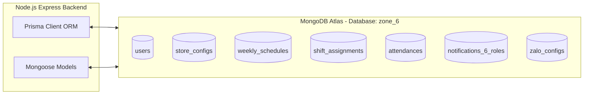

# 🗄️ TỔNG QUAN KIẾN TRÚC CƠ SỞ DỮ LIỆU ZONE SIX (MONGODB ATLAS)

---

## 1. NỀN TẢNG KỸ THUẬT & KẾT NỐI

- **Hệ quản trị CSDL:** MongoDB Atlas (NoSQL Document Store, Replication Cluster)
- **Database Name:** `zone_6`
- **Công cụ ORM/ODM:** Prisma ORM Client (kết hợp Prisma Multi-File Schema Folder) & Mongoose Schema song hành.
- **Mục tiêu thiết kế:** Đảm bảo khả năng mở rộng linh hoạt theo mô hình chuỗi đa cơ sở (Multi-store), phân lập dữ liệu nghiêm ngặt theo vai trò và đảm bảo tốc độ truy vấn cao thông qua hệ thống chỉ mục (Indexes) tối ưu.

---

## 2. NGUYÊN TẮC PHÂN LẬP DỮ LIỆU ĐA CƠ SỞ (DATA SCOPING AT DATABASE LEVEL)

Mọi dữ liệu nghiệp vụ vận hành hàng ngày (Lịch làm, Ca trực, Điểm danh, Thông báo, Zalo) đều được gắn định danh cơ sở `store_id` (hoặc `storeId`):

| Nhóm Thực Thể | Cơ Chế Phân Lập Cơ Sở | Ràng Buộc Khóa & Index |
| :--- | :--- | :--- |
| **Cơ Sở (`store_configs`)** | Mỗi cơ sở là 1 document độc lập chứa tọa độ GPS, bán kính quét và tên cơ sở. | `_id` (ObjectId), `store_name` (unique) |
| **Nhân Sự (`users`)** | - Admin: `assigned_stores = []` (Quyền toàn chuỗi hoặc danh sách cụ thể) - Quản lý: `assigned_stores = [id1, id2]` - **Trưởng ca: `assigned_store_id = id` (Đúng 1 cơ sở duy nhất)** - Nhân viên: `assigned_store_id = id` | `user_code` (unique), `email` (unique), `assigned_store_id` (index) |
| **Lịch Tuần (`weekly_schedules`)** | Mỗi cơ sở có 1 bảng lịch tuần riêng biệt cho từng tuần. | `store_id, week_start_date` (compound index) |
| **Phân Ca (`shift_assignments`)** | Thuộc về bảng lịch tuần của đúng cơ sở đó. | `store_id, user_id, work_date, shift_type` |
| **Điểm Danh (`attendances`)** | Ghi nhận tọa độ và đối chiếu với tọa độ chuẩn của cơ sở diễn ra ca làm. | `store_id, user_id, work_date` |
| **Thông Báo (`notifications_*`)** | 6 Table riêng biệt, mỗi thông báo mang `store_id` để Trưởng ca chỉ đọc thông báo quán mình. | `store_id, target_role, is_read` |
| **Zalo Bot (`zalo_configs`)** | Mỗi cơ sở cấu hình nhiều nhóm Zalo phân loại theo `channel_type` (CHECKIN, MATERIAL, SCHEDULE, GENERAL) để chống spam và bắn đúng nhóm đích. | `store_id, channel_type` (compound unique index) |

---

## 3. DANH BẠ 16 BẢNG DỮ LIỆU / COLLECTIONS CỦA HỆ THỐNG

| STT | Tên Collection MongoDB | Model Prisma | Mục Đích Nghiệp Vụ | Phân Hệ Liên Quan |
| :---: | :--- | :--- | :--- | :--- |
| 1 | `users` | `User` | Lưu trữ tài khoản, vai trò, lương/giờ, mã QR, cơ sở phân bổ | CN01, CN02 |
| 2 | `store_configs` | `StoreConfig` | Quản lý danh mục cơ sở, tọa độ GPS, bán kính quét Geofence | CN06 |
| 3 | `weekly_schedules` | `WeeklySchedule` | Bảng lịch tuần tổng thể theo cơ sở | CN04, CN07 |
| 4 | `shift_assignments` | `ShiftAssignment` | Chi tiết ca làm từng ngày của nhân viên | CN04 |
| 5 | `shift_registrations` | `ShiftRegistration` | Bản ghi nguyện vọng ca tuần của nhân viên | CN03 |
| 6 | `registration_windows` | `RegistrationWindow` | Cấu hình mở/khóa cổng đăng ký ca tuần theo cơ sở | CN03 |
| 7 | `attendances` | `Attendance` | Bằng chứng check-in (ảnh camera selfie, tọa độ GPS, giờ thực) | CN05 |
| 8 | `notifications_truong_ca` | `NotificationTruongCa` | Thông báo cảnh báo ca trống, nhân viên trễ ca cho Trưởng ca | CN08 |
| 9 | `notifications_quan_ly` | `NotificationQuanLy` | Thông báo duyệt lịch, sự cố vận hành cho Quản lý | CN08 |
| 10 | `notifications_admin` | `NotificationAdmin` | Thông báo an ninh, lỗi hệ thống, Zalo Bot cho Admin | CN08 |
| 11 | `notifications_pho_ca_lam_lich` | `NotificationPhoCaLamLich` | Thông báo tiến độ đăng ký ca, hạn chót làm lịch | CN08 |
| 12 | `notifications_pho_ca_vat_lieu` | `NotificationPhoCaVatLieu` | Thông báo tồn kho, nhập nguyên vật liệu theo cơ sở | CN08, CN11 |
| 13 | `notifications_nhan_vien` | `NotificationNhanVien` | Thông báo lịch tuần mới duyệt, nhắc giờ ca làm cá nhân | CN08 |
| 14 | `schedule_notifications` | `ScheduleNotification` | Bảng thông báo tổng hợp (fallback) | CN08 |
| 15 | `zalo_configs` | `ZaloConfig` | Cấu hình Group ID Zalo, ảnh lịch, mẫu tin nhắn theo cơ sở | CN10 |
| 16 | `subscription_plans` | `SubscriptionPlan` | Gói đăng ký dịch vụ phần mềm hệ thống chuỗi | Quản trị |

---

## 📁 CẤU TRÚC TÀI LIỆU TRONG THƯ MỤC NÀY

- [01_so_do_thuc_the_erd.md](./01_so_do_thuc_the_erd.md): Sơ đồ quan hệ thực thể (ERD) chi tiết với các khóa chính, khóa ngoại và chỉ mục liên kết chuỗi đa cơ sở.
- [02_chi_tiet_cac_collection.md](./02_chi_tiet_cac_collection.md): Đặc tả chi tiết từng trường dữ liệu, kiểu dữ liệu, giá trị mặc định và validation rules của tất cả các bảng.
- [03_quy_trinh_seed_va_migration.md](./03_quy_trinh_seed_va_migration.md): Quy trình khởi tạo dữ liệu mẫu, dọn dẹp an toàn và đồng bộ schema vào MongoDB Atlas.
- [04_bao_cao_chi_tiet_prisma.md](./04_bao_cao_chi_tiet_prisma.md): **Báo cáo học thuật chi tiết 100% toàn bộ 32 bảng, thuộc tính và mối quan hệ trích xuất từ Prisma Schema để nộp đồ án / giảng viên.**
