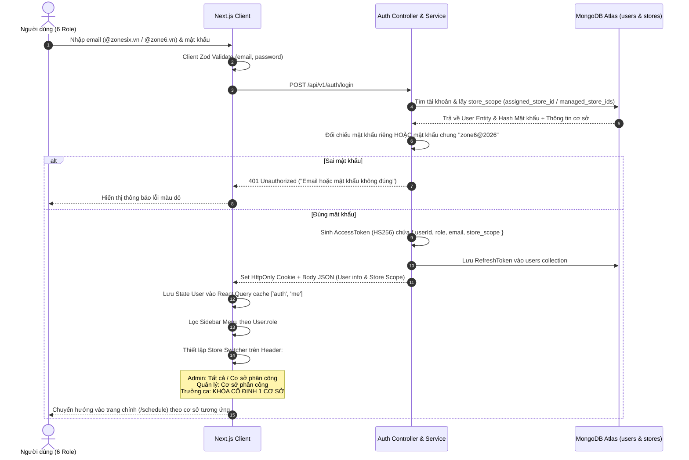

# 🔐 LUỒNG 01: XÁC THỰC, CẤP PHÁT TOKEN & PHÂN QUYỀN STORE SCOPE (MULTI-STORE)

---

## 1. SƠ ĐỒ TUẦN TỰ (SEQUENCE DIAGRAM)

---

## 2. CHI TIẾT CÁC BƯỚC THỰC THI

### Bước 1: Tiếp Nhận & Chuẩn Hóa Thông Tin Đăng Nhập
- Hệ thống hỗ trợ tính năng tên miền linh hoạt: Mọi email có đuôi `@zone6.vn` được tự động chuẩn hóa về `@zonesix.vn`.
- Mật khẩu: Chấp nhận mật khẩu riêng cá nhân hoặc mật khẩu dự phòng hệ thống `zone6@2026`.

### Bước 2: Cấp Phát Token & Nạp Thông Tin Store Scope
- **AccessToken:** Mang payload `{ userId, email, role, fullName, store_scope }`, hạn 15 phút.
  - `store_scope`:
    - `admin_he_thong`: `'ALL'` (hoặc mảng `managed_store_ids`).
    - `quan_ly`: Mảng `managed_store_ids` (các cơ sở được giao).
    - `truong_ca`: **Đúng 1 ID cơ sở duy nhất** `assigned_store_id`.
    - `pho_ca_lam_lich`, `pho_ca_vat_lieu`, `nhan_vien`: Đúng 1 ID cơ sở biên chế.
- **RefreshToken:** Hạn 7 ngày, lưu trong database MongoDB Atlas.

### Bước 3: Phân Luồng Giao Diện & Bộ Chuyển Đổi Cơ Sở (Store Switcher)
- **Cấu hình Topbar / Header:**
  - Nếu là `admin_he_thong`: Header hiển thị Store Switcher với tùy chọn "Tất cả cơ sở" hoặc danh sách từng cơ sở trong chuỗi.
  - Nếu là `quan_ly`: Header hiển thị Store Switcher với danh sách các cơ sở mình được giao quản lý.
  - Nếu là `truong_ca`: **Tuyệt đối không có Store Switcher**. Hệ thống ghim cố định tên cơ sở của Trưởng ca lên thanh tiêu đề.
- **Phân luồng Sidebar Menu theo Role:**
  - `admin_he_thong`: Menu Quản Lý Cơ Sở, Zalo Bot, Cấu hình GPS, Nhân sự, Lịch, Lương.
  - `quan_ly`: Menu Cấu hình GPS (cơ sở mình), Nhân sự (cơ sở mình), Lịch, Lương.
  - `truong_ca`: Menu Nhân sự cấp dưới (cơ sở mình), Lịch (cơ sở mình), Lương (cơ sở mình).
  - `pho_ca_lam_lich`, `pho_ca_vat_lieu`, `nhan_vien`: Menu Xếp Lịch / Đăng Ký Ca / Hồ Sơ Cá Nhân tại cơ sở mình.

