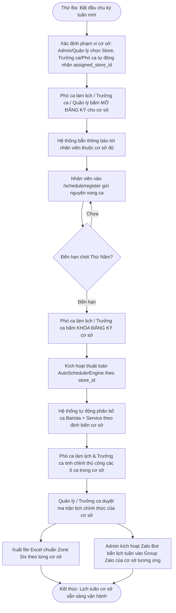

# 📅 LUỒNG 02: CHU KỲ XẾP LỊCH TUẦN ĐA CƠ SỞ (WEEKLY SCHEDULING CYCLE)

---

## 1. SƠ ĐỒ QUY TRÌNH CHU KỲ TUẦN (WORKFLOW DIAGRAM)



---

## 2. CHI TIẾT CÁC BƯỚC THỰC HIỆN

### Bước 1: Xác Định Cơ Sở & Mở Cổng Đăng Ký Ca Tuần
- **Phạm vi cơ sở:**
  - **Admin hệ thống:** Chọn cơ sở từ Store Switcher (hoặc chạy hàng loạt cho nhiều cơ sở được phân công).
  - **Quản lý quán:** Chọn cơ sở trong danh sách phụ trách.
  - **Trưởng ca & Phó ca làm lịch:** Hệ thống tự động khóa chặt theo `assigned_store_id` (không có menu chọn cơ sở, không được can thiệp cơ sở khác).
- **Thao tác:** Bấm nút "Mở Đăng Ký" trên giao diện bảng lịch tuần của cơ sở đang chọn.
- **API Call:** `PUT /api/v1/scheduling/registrations/status` với body:
  ```json
  {
    "store_id": "STORE_01_ID",
    "isOpen": true,
    "weekNumber": 43,
    "year": 2026
  }
  ```
- **Hệ thống:** Cập nhật trạng thái `isRegistrationOpen: true` theo `store_id` và gửi thông báo nhắc nhở tới toàn bộ nhân viên biên chế tại cơ sở đó.

### Bước 2: Nhân Viên Gửi Nguyện Vọng
- **Người thực hiện:** Tất cả nhân viên (Barista & Service) thuộc biên chế cơ sở.
- **Thao tác:** Truy cập `/schedule/register`, giao diện tự động tải danh sách ca của cơ sở mình. Nhân viên chọn ca sáng (07:00-12:30), chiều (12:30-18:00), tối (18:00-23:00) hoặc full ngày cho từng ngày trong tuần.
- **API Call:** `POST /api/v1/scheduling/registrations` lưu danh sách ca mong muốn kèm `store_id`.

### Bước 3: Đóng Cổng & Khóa Dữ Liệu Cơ Sở
- Khi đến hạn chốt (thường là tối Thứ Năm), Phó ca làm lịch hoặc Trưởng ca của cơ sở bấm "Khóa Đăng Ký".
- Mọi thao tác gửi hoặc sửa đổi của nhân viên tại cơ sở này bị chặn ngay lập tức (`isRegistrationOpen: false`).

### Bước 4: Chạy Thuật Toán Xếp Ca Tự Động (AutoScheduler)
- **Người thực hiện:** Phó ca làm lịch, Trưởng ca (cho cơ sở của mình) hoặc Quản lý / Admin.
- **API Call:** `POST /api/v1/scheduling/auto-schedule` với payload `{ "store_id": "STORE_01_ID", "weekNumber": 43, "year": 2026 }`.
- **Xử lý Backend:**
  - Thuật toán đọc toàn bộ bản ghi đăng ký tuần thuộc đúng `store_id`.
  - Phân loại nhân sự theo chuyên môn (Barista / Service) thuộc cơ sở.
  - Điền nhân sự vào các khung ca theo ma trận định biên chuẩn riêng của cơ sở đó (ví dụ Cơ sở 1: 3 Barista + 3 Service; Cơ sở 2 nhỏ hơn: 2 Barista + 2 Service).
  - Tự động cân bằng tải giờ làm (mỗi nhân viên nhận trung bình từ 4 - 6 ca/tuần, không ai bị quá 8 ca hoặc dưới 2 ca).
  - Trả về bản nháp ma trận lịch tuần (`draft schedule`) của cơ sở.

### Bước 5: Tinh Chỉnh Thủ Công & Duyệt Lịch
- Phó ca làm lịch rà soát lại các ô ca, nhấp chuột vào từng ô ca để thay thế nhân viên nếu có yêu cầu tăng cường đặc biệt tại quán.
- Trưởng ca kiểm tra sự cân đối nhân sự trong từng ca trực của quán mình.
- Quản lý phụ trách hoặc Trưởng ca xác nhận duyệt lịch chính thức (`status: 'PUBLISHED'`) cho cơ sở.

### Bước 6: Xuất Bản & Truyền Thông Đa Cơ Sở
- Xuất file bảng lịch Excel Zone Six bằng thư viện `ExcelJS` theo mẫu riêng có in rõ tiêu đề: **Zone Six - Chi Nhánh [Tên Cơ Sở]** để in ra giấy dán tại bảng tin quầy bar.
- Zalo Bot tự động gửi ảnh chụp lịch tuần kèm tin nhắn danh sách ca vào Group Zalo nội bộ của đúng cơ sở đó (dựa trên cấu hình `zalo_group_id` của từng cơ sở).

