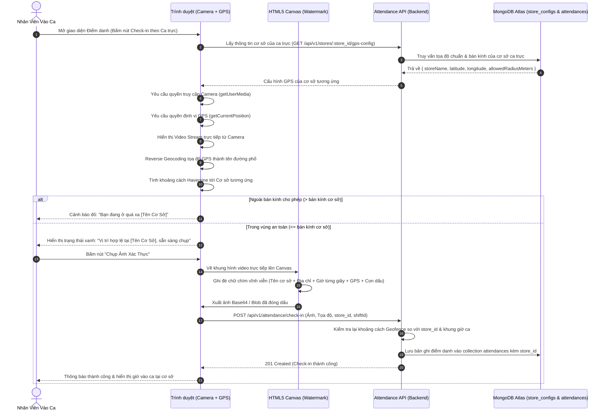

# 📸 LUỒNG 03: ĐIỂM DANH CHECK-IN CAMERA THỰC TẾ & ĐỊNH VỊ GPS ĐA CƠ SỞ

---

## 1. SƠ ĐỒ TUẦN TỰ (SEQUENCE DIAGRAM)

---

## 2. CHI TIẾT CÁC BƯỚC KỸ THUẬT

### Bước 1: Khởi Tạo & Xác Định Tọa Độ Cơ Sở Của Ca Trực
- Khi nhân viên bấm check-in cho một ca trực trong ngày, hệ thống truy xuất thông tin ca trực để lấy `store_id` của cơ sở diễn ra ca làm việc.
- Gọi API lấy thông tin cấu hình GPS chuẩn của cơ sở đó (`latitude`, `longitude`, `allowedRadiusMeters`, `storeName`).
- Hệ thống gọi đồng thời 2 Web APIs tiêu chuẩn của trình duyệt:
  1. `navigator.mediaDevices.getUserMedia({ video: { facingMode: 'user', width: 1280, height: 720 } })` để hiển thị khung hình camera trực tiếp. Khóa hoàn toàn mọi hành vi chọn file ảnh từ thư viện máy.
  2. `navigator.geolocation.getCurrentPosition({ enableHighAccuracy: true })` để lấy tọa độ có độ chính xác cao nhất.

### Bước 2: Kiểm Tra Địa Lý Với Cơ Sở Tương Ứng (Geofence Validation)
- Sử dụng công thức Haversine để tính khoảng cách đường chim bay giữa tọa độ thực tế của nhân viên và tọa độ của cơ sở ca trực:
  $$d = 2R \times \arcsin\left(\sqrt{\sin^2\left(\frac{\Delta\varphi}{2}\right) + \cos(\varphi_1)\cos(\varphi_2)\sin^2\left(\frac{\Delta\lambda}{2}\right)}\right)$$
- Nếu khoảng cách $d > \text{allowedRadiusMeters}$ của cơ sở đó (thường từ 30m - 50m tùy mặt bằng chi nhánh), giao diện hiện cảnh báo đỏ rõ ràng: *"Bạn đang cách cơ sở [Tên cơ sở] X mét (vượt mức cho phép)"*, nút chụp ảnh bị vô hiệu hóa.

### Bước 3: Đóng Dấu Chìm Vĩnh Viễn Trên Pixel (Watermark Burn-in Đa Cơ Sở)
- Tạo phần tử `<canvas>` tương ứng kích thước ảnh chụp.
- Vẽ ảnh từ camera lên canvas: `ctx.drawImage(videoElement, 0, 0)`.
- Đổ dải nền mờ bảo vệ phía dưới ảnh và ghi đè bằng hàm `ctx.fillText`:
  - **Dòng 1:** 🏢 [ZONE SIX - CHI NHÁNH: {storeName}]
  - **Dòng 2:** 📍 [Địa chỉ đường phố thực tế từ Reverse Geocoding]
  - **Dòng 3:** 🕒 [Thời gian chụp: DD/MM/YYYY HH:mm:ss]
  - **Dòng 4:** 🧭 [Tọa độ GPS: Lat, Long | Khoảng cách: X mét tới quán]
  - **Dòng 5:** 🛡️ [HỆ THỐNG ĐIỂM DANH XÁC THỰC CAMERA & GPS CHÍNH CHỦ]
- Chuyển canvas thành định dạng ảnh Base64 / Blob không thể chỉnh sửa để gửi về Backend.

### Bước 4: Lưu Trữ & Xác Nhận Ca
- Backend nhận request, kiểm tra lại khoảng cách địa lý giữa tọa độ gửi lên và tọa độ cơ sở trong DB để chống gian lận can thiệp Frontend.
- Kiểm tra khung giờ ca trực so với giờ thực tế để xác định đi sớm, đúng giờ hay đi muộn.
- Lưu bản ghi điểm danh vào MongoDB Atlas collection `attendances` gồm: `userId`, `storeId`, `shiftId`, `timestamp`, `imageUrl`, `gpsCoordinates`, `distanceMeters`, `address`.
- Đánh dấu trạng thái ca của nhân viên là đã có mặt tại cơ sở tương ứng.

