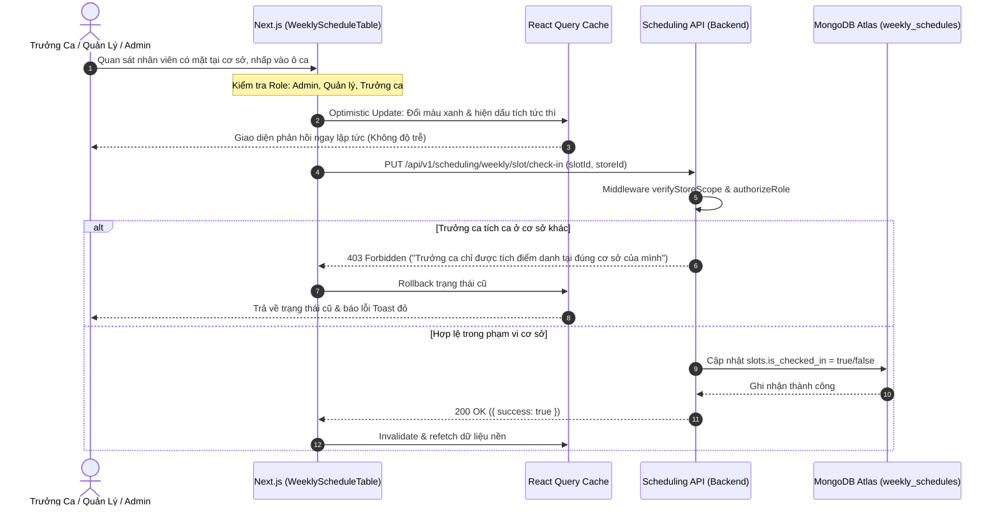

# ✅ LUỒNG 04: TÍCH ĐIỂM DANH TRỰC TIẾP TRÊN Ô CA LÀM VIỆC (DIRECT SLOT CHECK-IN)

---

## 1. SƠ ĐỒ TUẦN TỰ & KIỂM TRA STORE SCOPE (OPTIMISTIC UPDATE)



---

## 2. CHI TIẾT CÁC BƯỚC THỰC HIỆN

### Bước 1: Kiểm Soát Hiển Thị Theo Quyền Hạn & Cơ Sở
- Khi render component `ShiftSlotCell.tsx`:
  ```tsx
  const canDirectCheckIn = ['admin_he_thong', 'quan_ly', 'truong_ca'].includes(user?.role);
  // Nếu canDirectCheckIn === false: TUYỆT ĐỐI KHÔNG RENDER DẤU TÍCH CHECKBOX
  ```
- Phó ca làm lịch, Phó ca vật liệu và Nhân viên không nhìn thấy bất kỳ dấu tích nào trên bảng ca.

### Bước 2: Thao Tác Tích Điểm Danh Một Chạm (One-Click Check-in)
- Khi Trưởng ca, Quản lý hoặc Admin bấm vào ô ca của một nhân viên trong cơ sở mình phụ trách:
  - Nếu ca đó đang chưa điểm danh: Chuyển sang trạng thái ĐÃ CHECK-IN (Nền xanh lá nhẹ, icon tích xanh nổi bật).
  - Nếu ca đó đã điểm danh trước đó: Bấm lần nữa để HỦY CHECK-IN.

### Bước 3: Kiểm Tra Phạm Vi Cơ Sở (Store Scope Enforcement)
- **Đối với Trưởng ca (RÀNG BUỘC CỨNG):**
  - Chỉ được thao tác trên bảng lịch có `store_id === user.assigned_store_id`.
  - Nếu hệ thống phát hiện Trưởng ca gọi API tích ca cho cơ sở khác, lập tức chặn với mã lỗi `403 Forbidden`.
- **Đối với Quản lý:** Chỉ được tích ca trong các cơ sở thuộc `managed_store_ids`.
- **Đối với Admin:** Được phép thao tác trên tất cả các cơ sở.

### Bước 4: Cơ Chế Cập Nhật Lạc Quan (Optimistic Update)
- Để đảm bảo tốc độ thao tác tại quầy không bị khựng lại do mạng lag, React Query thực hiện Optimistic Update:
  - Lưu snapshot qua `onMutate`.
  - Cập nhật trực tiếp vào cache query `['weekly-schedule', storeId, weekNumber, year]`.
  - Nếu lỗi `onError`: Tự động rollback và hiện Toast thông báo lỗi.

### Bước 5: Cập Nhật Database & Đồng Bộ Bảng Lương Cơ Sở
- Backend cập nhật cờ `is_checked_in` trong mảng `slots` của collection `weekly_schedules` gắn với cơ sở đó.
- Căn cứ trực tiếp để phân hệ Bảng Lương (CN09) tính tổng giờ công theo cơ sở.

