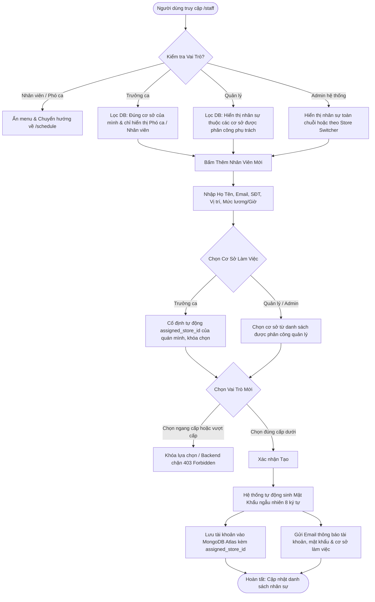

# 👥 LUỒNG 05: QUẢN LÝ NHÂN SỰ THEO PHÂN CẤP & PHẠM VI CƠ SỞ

---

## 1. SƠ ĐỒ QUY TRÌNH PHÂN CẤP & PHẠM VI CƠ SỞ (HIERARCHY & STORE SCOPE WORKFLOW)



---

## 2. CHI TIẾT CÁC BƯỚC THỰC HIỆN

### Bước 1: Phân Cấp Dữ Liệu Tự Động Theo Vai Trò & Cơ Sở (Auto Data Scoping)
- Khi gọi `GET /api/v1/users`:
  - **Trưởng ca (`truong_ca`):** Bị áp đặt bộ lọc kép bắt buộc:
    ```javascript
    query.assigned_store_id = currentUser.assigned_store_id; // Đúng 1 cơ sở của mình
    query.role = { $in: ['pho_ca_lam_lich', 'pho_ca_vat_lieu', 'nhan_vien'] }; // Đúng cấp dưới
    ```
    Trưởng ca hoàn toàn không thấy thông tin tài khoản, mức lương của Quản lý, Admin hay bất kỳ nhân sự nào thuộc chi nhánh khác.
  - **Quản lý (`quan_ly`):**
    ```javascript
    query.assigned_store_id = { $in: currentUser.assigned_stores };
    query.role = { $in: ['truong_ca', 'pho_ca_lam_lich', 'pho_ca_vat_lieu', 'nhan_vien'] };
    ```
  - **Admin hệ thống (`admin_he_thong`):** Toàn quyền truy vấn theo mọi cơ sở hoặc lọc theo từng cơ sở từ Store Switcher.

### Bước 2: Thêm Nhân Viên Mới & Quy Tắc Không Vượt Cấp
- Biểu mẫu `CreateStaffModal`:
  - **Chọn cơ sở làm việc:**
    - Trưởng ca: Bị gán cứng `assigned_store_id` vào cơ sở duy nhất của mình, ô chọn bị `disabled`.
    - Quản lý / Admin: Được chọn từ danh sách cơ sở có thẩm quyền.
  - **Chọn vai trò:**
    - Nếu người tạo là `quan_ly`: Dropdown vai trò chỉ hiển thị `truong_ca`, `pho_ca_lam_lich`, `pho_ca_vat_lieu`, `nhan_vien`.
    - Nếu người tạo là `truong_ca`: Dropdown vai trò chỉ hiển thị `pho_ca_lam_lich`, `pho_ca_vat_lieu`, `nhan_vien`.
- Nếu kẻ gian cố tình bypass Frontend để gửi payload chứa role ngang/vượt cấp hoặc gán sang cơ sở khác, Backend kiểm tra:
  ```typescript
  const allowedRoles = ROLE_HIERARCHY[currentUser.role];
  if (!allowedRoles.includes(targetRole)) {
    throw new ForbiddenError("Không có quyền gán vai trò ngang cấp hoặc cao hơn");
  }
  if (currentUser.role === 'truong_ca' && targetStoreId !== currentUser.assigned_store_id) {
    throw new ForbiddenError("Trưởng ca chỉ được tạo nhân sự tại đúng cơ sở của mình");
  }
  ```

### Bước 3: Sinh Mật Khẩu Ngẫu Nhiên Bảo Mật (Secure Auto-Generation)
- **Người tạo không nhập mật khẩu:** Loại bỏ ô nhập mật khẩu để tránh tình trạng cấp trên đặt mật khẩu dễ đoán hoặc biết mật khẩu riêng của nhân viên.
- Backend tự động sinh chuỗi ký tự ngẫu nhiên an toàn (kết hợp chữ hoa, chữ thường, số và ký tự đặc biệt).
- Mật khẩu này được hash và lưu vào CSDL, đồng thời gửi trực tiếp đến hòm thư email của nhân viên kèm tên cơ sở làm việc và đường dẫn đăng nhập.

### Bước 4: Sửa Lương, Vai Trò & Điều Chuyển Cơ Sở
- Cấp trên có thể cập nhật lại mức thù lao theo giờ của nhân viên khi hoàn thành thử việc hoặc nâng bậc kỹ năng (Barista bậc 1, Barista bậc 2).
- **Quyền điều chuyển cơ sở:** Chỉ Admin hoặc Quản lý có thẩm quyền mới được phép đổi `assigned_store_id` của nhân viên giữa các cơ sở. Trưởng ca tuyệt đối không thể chuyển nhân viên sang chi nhánh khác.

