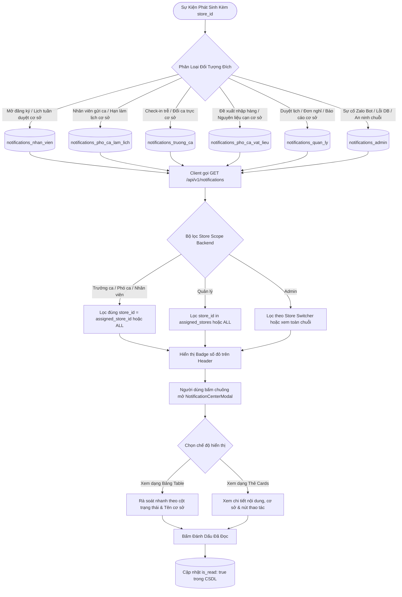

# 🔔 LUỒNG 06: PHÁT SINH, ĐIỀU PHỐI & TIẾP NHẬN THÔNG BÁO ĐA CƠ SỞ THEO VAI TRÒ

---

## 1. SƠ ĐỒ ĐIỀU PHỐI THÔNG BÁO ĐA CƠ SỞ (NOTIFICATION PIPELINE)



---

## 2. CHI TIẾT CÁC BƯỚC THỰC HIỆN

### Bước 1: Phát Sinh Sự Kiện & Định Tuyến Kèm Cơ Sở (Event & Store Routing)
- Khi có bất kỳ nghiệp vụ nào hoàn thành trong mã nguồn backend (Service layer):
  - Service gọi hàm điều phối thông báo dùng chung:
    ```typescript
    notificationService.createNotification({
      targetRole: 'truong_ca',
      storeId: 'STORE_01_ID', // hoặc null nếu áp dụng toàn chuỗi
      title: '...',
      content: '...',
      severity: 'high'
    });
    ```
  - Hàm lưu vào 1 trong 6 collection MongoDB Atlas tương ứng:
    - `admin_he_thong` $\rightarrow$ `NotificationAdmin`
    - `quan_ly` $\rightarrow$ `NotificationQuanLy`
    - `truong_ca` $\rightarrow$ `NotificationTruongCa`
    - `pho_ca_lam_lich` $\rightarrow$ `NotificationPhoCaLamLich`
    - `pho_ca_vat_lieu` $\rightarrow$ `NotificationPhoCaVatLieu`
    - `nhan_vien` $\rightarrow$ `NotificationNhanVien`

### Bước 2: Lọc Thông Báo Theo Store Scope (Data Isolation)
- Khi người dùng mở ứng dụng hoặc gọi API `GET /api/v1/notifications`:
  - **Trưởng ca (`truong_ca`):** Bắt buộc chỉ nhận thông báo có `store_id === currentUser.assigned_store_id` hoặc thông báo toàn chuỗi (`store_id === null`). Tuyệt đối không nhận thông báo về điểm danh trễ, nhân sự hay sự cố của cơ sở khác.
  - **Quản lý (`quan_ly`):** Lọc các thông báo thuộc danh sách các cơ sở phụ trách (`assigned_stores`).
  - **Admin hệ thống (`admin_he_thong`):** Nhận toàn bộ thông báo hệ thống và có thể dùng Store Switcher để lọc riêng từng cơ sở.

### Bước 3: Gắn Nhãn Cấp Độ Cảnh Báo (Severity Tagging)
- Mỗi thông báo được gán 1 trong 4 mức độ:
  - `urgent` (Khẩn cấp): Dành cho sự cố hệ thống, mất phiên Zalo, nhân viên vắng ca đột xuất tại cơ sở.
  - `high` (Cao): Dành cho lịch tuần mới được duyệt của chi nhánh, nhắc nhở ca trực sắp tới trong vòng 1-2 giờ.
  - `medium` (Trung bình): Nhắc nhở nộp nguyện vọng ca tuần tại cơ sở, yêu cầu đổi ca trực.
  - `low` (Thông thường): Lời chúc ca làm việc, thông báo bảo trì định kỳ.

### Bước 4: Hiển Thị Tại NotificationCenterModal
- **Trải nghiệm Dead-Center:** Modal hiển thị chính giữa màn hình thông qua React Portal gắn vào `document.body`.
- Lớp phủ mờ `backdrop-blur-md` làm nổi bật thông báo và khóa cuộn chuột trên trang nền (`body scroll-lock`).
- Mỗi thẻ thông báo hiển thị rõ **Badge Tên Cơ Sở** để người quản lý nhiều cơ sở nhận diện ngay chi nhánh phát sinh thông báo.
- Nút chuyển đổi giữa **Chế độ Thẻ (Cards)** và **Chế độ Bảng (Table)** giúp người dùng linh hoạt giữa đọc chi tiết và rà soát hàng loạt.

### Bước 5: Đánh Dấu Đã Đọc (Mark as Read)
- Bấm vào thông báo: Gửi `PUT /api/v1/notifications/:id/read` cập nhật `is_read = true`. Badge trên Header tự động giảm số lượng.
- Bấm "Đánh dấu tất cả đã đọc": Gửi `PUT /api/v1/notifications/read-all` để xóa sạch số lượng thông báo chưa đọc trong phạm vi cơ sở được xem.

