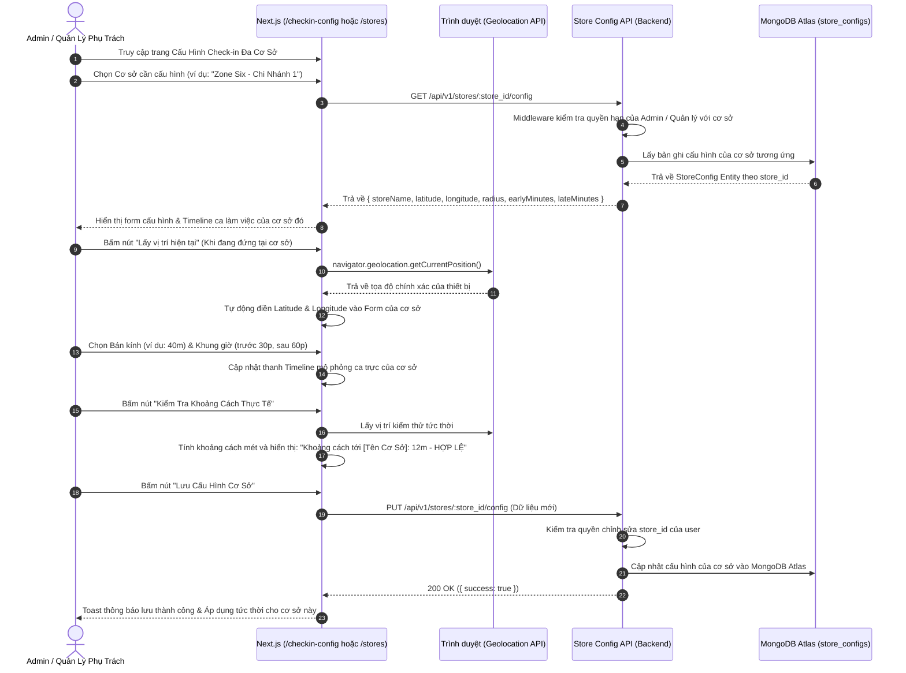

# ⚙️ LUỒNG 07: THIẾT LẬP CẤU HÌNH ĐỊNH VỊ GPS & KIỂM TRA KHOẢNG CÁCH THEO TỪNG CƠ SỞ

---

## 1. SƠ ĐỒ TUẦN TỰ THIẾT LẬP GPS & KIỂM THỬ ĐA CƠ SỞ

---

## 2. CHI TIẾT CÁC BƯỚC THỰC HIỆN

### Bước 1: Chọn Cơ Sở & Nạp Thông Số Hiện Hành
- Khi truy cập `/checkin-config`:
  - **Admin hệ thống:** Có danh sách thả xuống toàn bộ cơ sở trong chuỗi để chọn cơ sở muốn thiết lập.
  - **Quản lý (`quan_ly`):** Chỉ hiển thị các cơ sở nằm trong danh sách được phân công phụ trách (`assigned_stores`).
  - **Trưởng ca / Phó ca / Nhân viên:** Bị chặn truy cập (403 Forbidden).
- Sau khi chọn cơ sở (`store_id`), hệ thống gọi `GET /api/v1/stores/:store_id/config` để tải các tham số đang hoạt động của chi nhánh đó:
  - Tên cơ sở và địa chỉ đường phố.
  - Tọa độ địa lý: Vĩ độ (`latitude`) và Kinh độ (`longitude`).
  - Bán kính quét điểm danh: Tùy chỉnh theo mặt bằng thực tế (30m - 100m, mặc định 50m).
  - Khung giờ ca: Cho phép check-in trước giờ ca (`earlyCheckInMinutes`) và sau giờ ca (`lateCheckInMinutes`).

### Bước 2: Tự Động Định Vị Bằng Một Nút Bấm Tại Cơ Sở
- Để tránh việc cấp quản lý phải mở Google Maps tra cứu thủ công dễ dẫn đến sai lệch số thập phân:
  - Người thiết lập đứng trực tiếp tại cơ sở đó và bấm nút **"Lấy Vị Trí Hiện Tại"**.
  - Trình duyệt kích hoạt cảm biến GPS phần cứng với tham số `{ enableHighAccuracy: true }` để bắt lấy tọa độ chính xác đến từng mét và tự động điền vào biểu mẫu của chi nhánh.

### Bước 3: Mô Phỏng Trực Quan Bằng Thanh Timeline Ca Làm
- Giao diện cung cấp thanh mô phỏng tiến trình thời gian trực quan cho cơ sở đang chọn:
  - Vùng xám nhạt: Thời gian trước ca ngoài vùng cho phép (Bị từ chối).
  - Vùng xanh lục: Khung giờ vàng cho phép check-in hợp lệ.
  - Điểm mốc: Thời điểm bắt đầu ca trực (ví dụ: 07:00).
  - Vùng cam: Khung giờ đến trễ vẫn được phép chụp ảnh chấm công kèm cảnh báo.
  - Vùng đỏ: Ca đã trôi qua quá thời hạn quy định (Khóa điểm danh).

### Bước 4: Kiểm Thử Trực Tiếp Theo Cơ Sở (Store Distance Tester)
- Trước khi lưu vào hệ thống để áp dụng cho nhân viên chi nhánh, quản lý bấm **"Kiểm Tra Khoảng Cách Thực Tế"**:
  - Tiện ích thực hiện đo đạc tức thời so với tọa độ của chi nhánh đang chọn và đưa ra kết luận trực quan bằng huy hiệu (Badge):
    - *Xanh lá:* "HỢP LỆ (Khoảng cách Xm $\le$ bán kính cho phép của [Tên Cơ Sở])".
    - *Đỏ:* "QUÁ XA (Khoảng cách Xm vượt quá bán kính cho phép của [Tên Cơ Sở])".

### Bước 5: Lưu Trữ & Đồng Bộ Tức Thời Cho Cơ Sở
- Khi bấm "Lưu Cấu Hình Cơ Sở", dữ liệu được cập nhật vào MongoDB Atlas collection `store_configs` gắn với đúng `store_id`.
- Ngay lập tức, mọi lượt check-in của nhân viên thuộc ca trực tại cơ sở này sẽ được đối chiếu theo tọa độ và quy định giờ giấc mới cập nhật. Các cơ sở khác trong hệ thống không bị ảnh hưởng.

