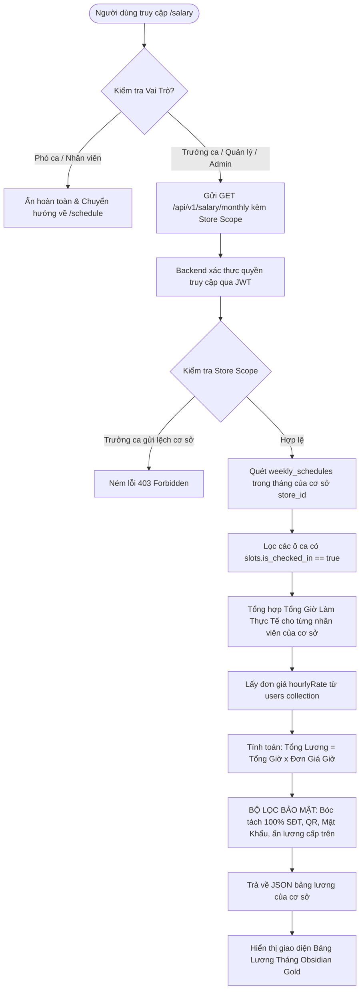

# 💰 LUỒNG 08: TÍNH CÔNG THỰC TẾ & HIỂN THỊ BẢNG LƯƠNG BẢO MẬT ĐA CƠ SỞ

---

## 1. SƠ ĐỒ QUY TRÌNH TÍNH LƯƠNG & BẢO MẬT DỮ LIỆU ĐA CƠ SỞ



---

## 2. CHI TIẾT CÁC BƯỚC THỰC HIỆN

### Bước 1: Rào Chắn Phân Quyền & Ràng Buộc Phạm Vi Cơ Sở (Store Scope Protection)
- **Tầng Giao Diện:** 
  - Sidebar chỉ render tab Bảng Lương đối với 3 vai trò: `admin_he_thong`, `quan_ly`, `truong_ca`. Các vai trò cấp dưới bị ẩn hoàn toàn (tránh so bì lương).
  - Trưởng ca chỉ thấy Badge tên cơ sở duy nhất của mình, hoàn toàn không có Dropdown chọn cơ sở khác.
  - Quản lý / Admin có dropdown chọn cơ sở trong phạm vi phụ trách.
- **Tầng Route Client:** Trang `/salary/page.tsx` kiểm tra session người dùng, nếu thuộc nhóm bị chặn sẽ lập tức kích hoạt `router.replace('/schedule')`.
- **Tầng Backend Controller & Middleware:**
  - Middleware `authorizeRole(['admin_he_thong', 'quan_ly', 'truong_ca'])`.
  - Middleware `verifyStoreScope`:
    ```typescript
    if (currentUser.role === 'truong_ca') {
      if (req.query.store_id && req.query.store_id !== currentUser.assigned_store_id) {
        throw new ForbiddenError("Trưởng ca chỉ có quyền xem bảng lương tại đúng cơ sở của mình");
      }
      req.query.store_id = currentUser.assigned_store_id; // Cưỡng chế gán cơ sở
    }
    ```

### Bước 2: Trích Xuất Dữ Liệu Công Thực Tế Theo Cơ Sở
- Thay vì tính công dựa trên lịch xếp lý thuyết, hệ thống trích xuất chính xác từ **các ca đã được điểm danh thực tế** thuộc đúng `store_id`:
  - Dữ liệu lấy từ các slot có cờ `is_checked_in: true` trong `weekly_schedules` của cơ sở (đã được Trưởng ca tích hoặc do nhân viên check-in Camera + GPS tại cơ sở thành công).
  - Tự động quy đổi thời lượng từng loại ca (Ca sáng 5.5 tiếng, Ca chiều 5.5 tiếng, Ca tối 5 tiếng).

### Bước 3: Nhân Đơn Giá & Tính Thù Lao
- Hệ thống join với bảng `users` để lấy trường `hourlyRate` của nhân sự cơ sở đó (ví dụ: 22.000 VNĐ/giờ cho nhân viên mới, 25.000 - 30.000 VNĐ/giờ cho Barista có kinh nghiệm hoặc Trưởng ca).
- Áp dụng công thức:
  $$\text{Lương Cơ Bản} = \text{Tổng Giờ Làm Thực Tế} \times \text{Mức Lương/Giờ}$$

### Bước 4: Thực Thi Quy Chuẩn Bảo Mật Thông Tin Nội Bộ
- Để bảo vệ sự riêng tư và ngăn ngừa tình trạng phát tán thông tin nhạy cảm của nhân viên:
  - Backend tuyệt đối không đính kèm trường `phone`, `password`, `qrCodeUrl` trong response trả về.
  - Khi Trưởng ca xem bảng lương cơ sở: Hệ thống tự động lọc bỏ bản ghi của Quản lý hoặc Admin (Trưởng ca không được biết lương cấp trên).
  - Bảng lương hiển thị thanh lịch, minh bạch chỉ với: Họ tên, Vị trí (Barista/Service), Tên cơ sở, Mức lương/giờ, Tổng số giờ làm và Tổng số tiền nhận.

