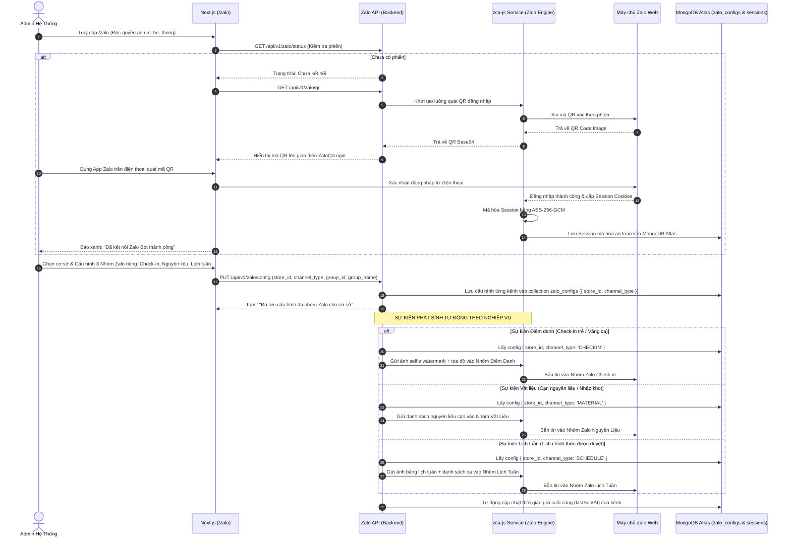

# 🤖 LUỒNG 09: KẾT NỐI PHIÊN ZALO WEB, LƯU CẤU HÌNH & TỰ ĐỘNG GỬI TIN ĐA KÊNH NGHIỆP VỤ

---

## 1. SƠ ĐỒ TUẦN TỰ KẾT NỐI & ĐỊNH TUYẾN TIN NHẮN ZALO BOT

---

## 2. CHI TIẾT CÁC BƯỚC THỰC HIỆN

### Bước 1: Bảo Mật Cấp Quyền Độc Quyền Admin (Zero-Trace Protection)
- Module Zalo Bot chỉ mở cổng duy nhất cho `admin_he_thong`.
- Khi bất kỳ tài khoản nào khác (kể cả Quản lý hay Trưởng ca) cố tình truy cập `/zalo`, Frontend tự động chuyển hướng ngay lập tức về `/schedule` và trả về `null`.
- Tầng Backend Express bảo vệ 100% routes `/api/v1/zalo/*` bằng middleware `requireRoles('admin_he_thong')`.

### Bước 2: Quét Mã QR & Duy Trì Phiên Đăng Nhập Duy Nhất
- Sử dụng thư viện `zca-js` để giả lập phiên đăng nhập Zalo Web. Hệ thống chỉ cần duy trì **1 phiên tài khoản Zalo Bot duy nhất** của Admin để gửi tin nhắn đến các nhóm khác nhau của mọi cơ sở trong toàn chuỗi.
- Sau khi Admin quét mã QR thành công, token và cookies phiên được mã hóa an toàn bằng thuật toán mã hóa đối xứng **AES-256-GCM** trước khi lưu vào MongoDB Atlas.
- Khi backend khởi động lại, hệ thống tự động giải mã session và tái kết nối ngầm mà Admin không cần phải quét lại mã QR.

### Bước 3: Lưu Trữ Cấu Hình Đa Kênh Nhóm Nghiệp Vụ (Multi-Channel Group Config)
- Cấu hình truyền thông được lưu bền vững vào MongoDB Atlas collection `zalo_configs` (model `ZaloConfig`) theo bộ đôi `{ store_id, channel_type }`:
  - `store_id`: ID của cơ sở tương ứng
  - `channel_type`: `CHECKIN`, `MATERIAL`, `SCHEDULE`, `GENERAL`
  - `group_id`: ID nhóm Zalo nội bộ phụ trách nghiệp vụ đó
  - `group_name`: Tên nhóm Zalo gợi nhớ
  - `template_message`: Mẫu tin nhắn định dạng riêng cho từng kênh
  - `is_active`: Bật / Tắt kích hoạt tự động gửi tin
- Giao diện Admin cung cấp Store Switcher để chọn cơ sở, sau đó hiển thị 3 khối cấu hình riêng biệt tương ứng cho 3 nhóm Zalo để Admin nhập Group ID độc lập.

### Bước 4: Tự Động Định Tuyến & Bắn Tin Đúng Nhóm Đích (Intelligent Event Dispatching)
- Hệ thống lắng nghe các sự kiện nghiệp vụ trong backend:
  1. **Khi có check-in trễ / vắng ca:** Trích xuất cấu hình `{ store_id, channel_type: 'CHECKIN' }` $\rightarrow$ Bắn ảnh chấm công và cảnh báo vào **Nhóm Điểm Danh**.
  2. **Khi Phó ca vật liệu báo hết hàng / yêu cầu nhập kho:** Trích xuất cấu hình `{ store_id, channel_type: 'MATERIAL' }` $\rightarrow$ Bắn danh sách hàng cạn vào **Nhóm Vật Liệu**.
  3. **Khi Lịch tuần được duyệt hoặc mở đăng ký:** Trích xuất cấu hình `{ store_id, channel_type: 'SCHEDULE' }` $\rightarrow$ Bắn ảnh bảng lịch tuần vào **Nhóm Lịch Tuần**.
- Các thông báo được phân luồng chính xác, không gây phiền toái hay loãng thông tin trong các nhóm khác.

